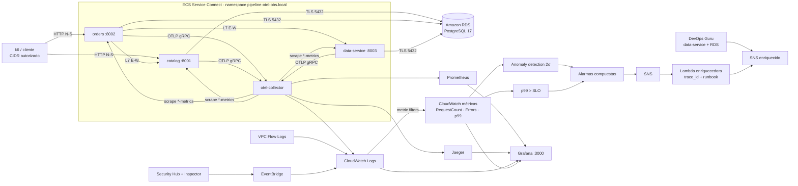

# Sistema observable en AWS (ID-003)

Laboratorio efímero que integra los tres pilares, OpenTelemetry, AIOps, observabilidad de red y
seguridad, SRE y caos controlado sobre AWS. Especificación y fases: [`specs/ID-003-sistema-observable`](../../specs/ID-003-sistema-observable/00-especificacion.md).



## Requisitos

- AWS CLI v2 autenticado en una cuenta sandbox, Terraform ≥ 1.6, Docker con buildx, k6 y Python ≥ 3.11.
- **DevOps Guru deja de aceptar clientes nuevos el 29-10-2026.** Si la cuenta nunca lo usó, aplicar
  antes de esa fecha o desactivar `enable_devops_guru` (la detección CloudWatch no depende de él).
- Si la cuenta ya tiene Security Hub o Inspector habilitados, poner `enable_security_hub = false` /
  `enable_inspector = false` para no gestionar recursos de cuenta existentes.

## Despliegue

```sh
cd infra/aws-observable
cp terraform.tfvars.example terraform.tfvars          # ajustar allowed_cidr (IP propia /32)
terraform init
terraform apply -target=module.ecr                    # 1) solo repositorios
mkdir -p ../../artifacts/aws
terraform output -json ecr_urls > ../../artifacts/aws/ecr_urls.json
cd ../..
python3 scripts/push-ecs-images.py us-east-1 artifacts/aws/ecr_urls.json obs-v1 --profile observable
terraform -chdir=infra/aws-observable apply           # 2) red, RDS (~10 min), ECS, AIOps, seguridad
terraform -chdir=infra/aws-observable output -json lab_config > artifacts/aws/lab_config.json
python3 scripts/aws/endpoints.py artifacts/aws/lab_config.json
aws secretsmanager get-secret-value --secret-id pipeline-otel-obs/grafana --query SecretString --output text
```

Cada tarea de aplicación ejecuta `db-bootstrap` (rol y esquema propios en RDS con el usuario maestro
gestionado por RDS) → `migrate` (Alembic) → `app`. Las IP públicas cambian al reemplazar tareas:
volver a ejecutar `endpoints.py`.

## Operación del laboratorio

| Paso | Comando | Evidencia |
|---|---|---|
| Línea base | `k6 run -e ORDERS_URL=… -e CATALOG_URL=… -e RATE=5 -e DURATION=4h scripts/load/steady.js` | Tráfico estable ≥ 3 h para entrenar las bandas de anomalía. |
| Traza completa | Jaeger → servicio `orders` → `POST /orders` | Spans orders → catalog → data-service y spans DB `INSERT data.order_records` con `db.namespace=pipeline\|data`. |
| Experimento 1 | `python3 scripts/chaos/run_experiment.py exp1-latency-catalog --config artifacts/aws/lab_config.json --prometheus http://IP:9090` | `artifacts/chaos/<ts>-exp1…/report.md` con MTTD, SLO y error budget. |
| Experimento 2 | `python3 scripts/chaos/run_experiment.py exp2-errors-data --config … --prometheus …` | Alerta correlacionada con `primary_trace_id`. |
| Ruido | `python3 scripts/aiops/noise_report.py --config artifacts/aws/lab_config.json --hours 6` | Tabla estático vs. AIOps. |
| Seguridad | `python3 scripts/security/generate_security_signals.py --grafana http://IP:3000 --failed-logins 8` y `--host IP --probe-ports` | Paneles de autenticación fallida y flujos rechazados. |

Esperar al menos 10 minutos entre experimentos para que las alarmas vuelvan a `OK`.

## Costo y limpieza

Con `desired_count = 1` el laboratorio cuesta del orden de 0,2 USD/h (Fargate 2,5 vCPU/6 GiB, RDS
`db.t4g.micro`, IPv4 públicas y CloudWatch). Security Hub e Inspector tienen periodo de prueba; las
alarmas de anomalía se facturan por métrica. `desired_count = 0` detiene el cómputo conservando RDS.

```sh
terraform -chdir=infra/aws-observable destroy
```

El destroy elimina RDS sin snapshot final, los repositorios ECR (`force_delete`) y deshabilita
Security Hub/Inspector/DevOps Guru si fueron habilitados por este módulo.
