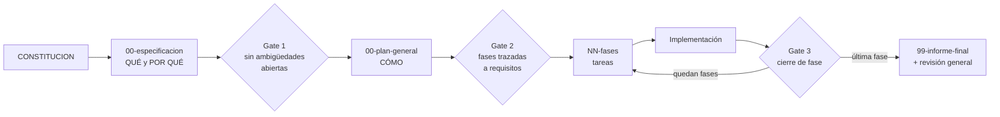

# Guía de trabajo para el agente

> **Qué es este archivo:** el contrato de trabajo sobre la carpeta `specs/` de un repositorio y sobre cada plan que contiene. Debe leerse antes de crear, ejecutar o cerrar cualquier fase.

## 1. Estructura de `specs/`

`specs/` vive en la raíz del repositorio de código al que aplica. Contiene dos archivos compartidos, una sola vez, y una subcarpeta por cada plan de implementación (funcionalidad, cambio o iniciativa).

```
specs/
├── GUIA-AGENTE.md              ← este archivo, una sola vez
├── CONSTITUCION.md             ← principios del repositorio, una sola vez
├── _template/                  ← punto de partida para un plan nuevo
│   ├── 00-especificacion.md    ←   archivos con placeholders entre corchetes;
│   ├── 00-plan-general.md      ←   nunca se edita directamente la plantilla:
│   ├── NN-nombre-fase.md       ←   se copia la carpeta completa
│   └── 99-informe-final.md
├── [ID-000]-[nombre-plan]/     ← una carpeta por plan, copiada de `_template/`
│   ├── 00-especificacion.md
│   ├── 00-plan-general.md
│   ├── NN-nombre-fase.md       ← una o más, desde 01
│   └── 99-informe-final.md
└── [ID-001]-[otro-plan]/
    └── ...
```

| Archivo | Vive en | Responde a | Se escribe | Se actualiza |
|---|---|---|---|---|
| `GUIA-AGENTE.md` | `specs/` (raíz) | Cómo se trabaja cualquier plan del repositorio | Una vez, al adoptar la convención | Solo si cambia el método de trabajo |
| `CONSTITUCION.md` | `specs/` (raíz) | Qué es innegociable para todo plan del repositorio | Antes del primer plan | Solo por decisión explícita registrada |
| `_template/` | `specs/` (raíz) | Punto de partida para un plan nuevo | Una vez, al adoptar la convención | Solo si cambia la plantilla |
| `00-especificacion.md` | `specs/[ID]-.../` | **Qué** se necesita y **por qué** | Primero, antes de cualquier diseño | Cuando cambia el comportamiento esperado |
| `00-plan-general.md` | `specs/[ID]-.../` | **Cómo** se va a construir | Después de la especificación | Al cerrar cada fase |
| `NN-nombre-fase.md` | `specs/[ID]-.../` | Qué se hace en cada tramo | Al descomponer el plan, desde `01` | Durante y al cerrar la fase |
| `99-informe-final.md` | `specs/[ID]-.../` | Qué quedó realmente entregado | Al cerrar, pausar o transferir el plan | Al cambiar el estado de cierre |

La numeración de fases arranca en `01`. El prefijo `00` lo comparten los dos documentos previos a las fases: `00-especificacion.md` (qué y por qué) y `00-plan-general.md` (cómo). El informe de cierre usa `99-informe-final.md`. `GUIA-AGENTE.md` y `CONSTITUCION.md` no se duplican dentro de cada carpeta de plan: viven una sola vez en `specs/` y todos los planes del repositorio los heredan.

**Para arrancar un plan nuevo:** copiar `specs/_template/` completa a `specs/[ID]-[nombre-plan]/`, con el identificador y nombre reales. `_template/` nunca se completa ni se usa como carpeta de trabajo: siempre es la fuente de la copia y conserva intactos sus placeholders entre corchetes.

## 2. Reglas de redacción innegociables

### 2.1 Redacción impersonal

Todo se redacta de forma impersonal, describiendo hechos técnicos y decisiones. No se atribuyen acciones a personas en tercera persona.

| Evitar | Usar |
|---|---|
| «Una persona validó el flujo contra el sistema externo» | «El flujo quedó validado contra el sistema externo» |
| «Decisión explícita de una persona» | «Decisión registrada en la bitácora (D-004)» |
| «Una persona debe confirmar el permiso» | «Queda pendiente confirmar el permiso» |
| «Se solicitó al equipo que...» | «Queda pendiente que el equipo...» |
| «Implementé el control» | «El control quedó implementado» |

Los roles sí se nombran cuando forman parte del diseño (`Administrador`, `Operador`, `Servicio`): describen el sistema, no atribuyen una acción.

### 2.2 Sin estado de control de versiones

Los documentos no contienen estado de repositorio: commits, ramas, solicitudes de cambio, merges, etiquetas ni frases como «pendiente de integración», «sin commit» o «integrado en la rama principal». Ese estado cambia fuera del plan y queda obsoleto de inmediato. Si aparece durante la ejecución, se reporta en la conversación y no se escribe en estos archivos.

Sí se conserva la información técnica estable:

- rutas de archivo y nombres de componentes (`src/services/resource-client.ts`, `ResourceService.requestUpdate`);
- contratos e interfaces (`POST /recurso` → `409 Conflict`);
- fragmentos de código cortos cuando el diseño no se entiende sin ellos;
- nombres de repositorios, servicios o plataformas que ubiquen el cambio.

### 2.3 Estado real, nunca optimista

Una fase no se marca `Completada` si solo existe diseño, código sin ejecutar o una validación parcial. Para ello existen los estados intermedios `Implementada sin validar` y `Bloqueada`. Un plan no se declara cerrado si queda alguna fase, validación o bloqueante abierto.

### 2.4 Ambigüedades explícitas

Cuando falte información para decidir, se escribe un marcador en el punto exacto del documento en lugar de asumir:

```
[NECESITA ACLARACIÓN: ¿la autorización aplica también a operaciones en ambientes no productivos?]
```

Ningún documento pasa a implementación con marcadores abiertos que afecten el alcance de esa fase. Los marcadores pendientes se consolidan en la sección de aclaraciones de `00-especificacion.md`.

### 2.5 Trazabilidad por identificador

Cada requisito de `00-especificacion.md` tiene un identificador (`RF-001`, `RNF-001`). Cada fase declara qué requisitos cubre y cada validación declara qué requisito verifica. Un requisito sin fase que lo cubra, o una fase que no cubre ningún requisito, es un error de descomposición que debe corregirse antes de implementar.

## 3. Flujo de trabajo



### Gate 1 — antes de escribir el plan general

- [ ] La especificación describe comportamiento esperado, no una solución técnica.
- [ ] Cada requisito tiene identificador y criterio de aceptación verificable.
- [ ] El fuera de alcance está explícito.
- [ ] No quedan marcadores `[NECESITA ACLARACIÓN]` que afecten el diseño.

### Gate 2 — antes de implementar

- [ ] Cada requisito de la especificación está cubierto por al menos una fase.
- [ ] Cada fase declara dependencias previas y qué se puede ejecutar en paralelo.
- [ ] Cada fase es implementable de forma autónoma, sin necesitar el contexto completo del resto.
- [ ] Los prerequisitos operativos están identificados con su impacto si faltan.
- [ ] Las decisiones con más de un camino razonable están consultadas y registradas en la bitácora, no resueltas de forma implícita.

### Gate 3 — al terminar cada fase

Este gate se ejecuta antes de pasar a la fase siguiente o de dar por terminada la implementación.

1. [ ] Actualizar el estado real de la fase en su propio `NN-*.md` (`Completada`, `Implementada sin validar` o `Bloqueada`).
2. [ ] Marcar las tareas efectivamente ejecutadas y el resultado de cada validación.
3. [ ] Registrar las desviaciones respecto al diseño inicial: qué se hizo distinto y por qué.
4. [ ] Propagar el estado a la tabla de fases de `00-plan-general.md`.
5. [ ] Actualizar riesgos, bloqueantes y prerequisitos en `00-plan-general.md`: cerrar los resueltos y agregar los descubiertos.
6. [ ] Si la implementación cambió el comportamiento esperado, actualizar `00-especificacion.md`; la especificación no puede describir algo que ya no sea cierto.
7. [ ] Registrar en la bitácora de decisiones toda decisión técnica tomada durante la fase.
8. [ ] Trasladar los pendientes no resueltos a la fase siguiente o declararlos como pendientes abiertos del plan.
9. [ ] Verificar que nada de lo escrito viole las reglas 2.1 y 2.2.

Una fase no se considera terminada hasta que los documentos reflejan lo que realmente ocurrió. Implementar sin actualizar la documentación deja la fase incompleta.

### Gate 4 — al terminar todas las fases

Al completar la última fase se ejecuta una revisión completa de la carpeta antes de escribir el informe final.

1. [ ] Leer los documentos de la carpeta completa de principio a fin, no solo los últimos modificados.
2. [ ] **Coherencia de estado:** el estado de cada fase coincide en su propio archivo y en la tabla de `00-plan-general.md`.
3. [ ] **Coherencia con lo implementado:** lo descrito corresponde al comportamiento real del sistema, incluidos los cambios de diseño realizados durante el trabajo.
4. [ ] **Trazabilidad:** cada requisito de la especificación tiene fase, resultado y evidencia; los no cubiertos aparecen como pendientes explícitos.
5. [ ] **Decisiones:** la bitácora recoge todas las decisiones relevantes, incluidas las alternativas descartadas.
6. [ ] **Riesgos y bloqueantes:** ninguno queda descrito como abierto si se resolvió, ni como cerrado si continúa abierto.
7. [ ] **Aclaraciones:** no quedan marcadores `[NECESITA ACLARACIÓN]` sin respuesta ni convertidos en pendiente explícito.
8. [ ] **Referencias:** los enlaces entre documentos y hacia otros planes resuelven.
9. [ ] **Reglas de redacción:** no hay atribuciones personales ni estado de control de versiones en ningún archivo.
10. [ ] Escribir `99-informe-final.md`, diferenciando implementación, validación e integración, y reportar en la conversación las inconsistencias corregidas durante la revisión.

## 4. Alcance de validación

Los documentos distinguen dos tipos de validación y nunca los mezclan en un mismo estado:

| Tipo | Quién la ejecuta | Ejemplos |
|---|---|---|
| **Automatizada / estática** | El agente, directamente | pruebas unitarias, lint, comprobación de tipos, validación de esquema o sintaxis, verificación de existencia de archivos |
| **Funcional / operativa** | Queda para ejecución manual y confirmación posterior | llamadas a sistemas reales, build o despliegue de la aplicación, flujos de integración o end-to-end, verificación contra servicios en vivo |

Para la validación funcional, el documento registra el comando exacto, endpoint o pasos, y el resultado esperado. Su estado permanece `Pendiente de confirmación` hasta registrar el resultado. Una fase con validación funcional pendiente se marca `Implementada sin validar`, no `Completada`.

## 5. Verificación contra documentación oficial

Cuando el comportamiento de una herramienta, plataforma o API condicione el diseño, se consulta la documentación oficial antes de escribirlo como hecho. Si la documentación no cubre el caso, el documento lo declara de forma explícita y etiqueta el razonamiento como hipótesis, no como hecho verificado.
