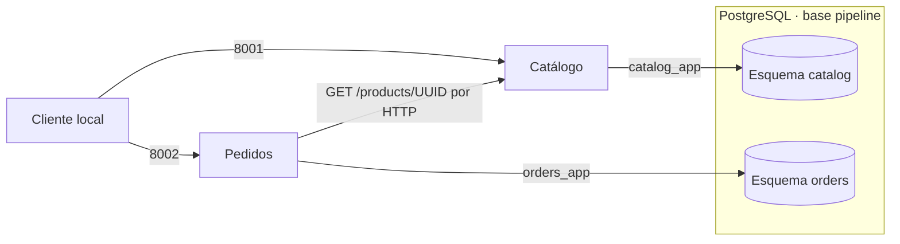

# ID-001 — Plan general: catálogo y pedidos locales

## Identificación

| Campo | Detalle |
|---|---|
| ID | ID-001 |
| Título | Microservicios de catálogo y pedidos con PostgreSQL y Docker Compose. |
| Sprint / iteración | No documentado. |
| Prioridad | Media. |
| Estado global | Implementado sin validar: código local presente; validaciones automatizadas y funcionales pendientes. |
| Sistemas y repositorios afectados | pipeline-otel-end-to-end; APIs, base de datos y entorno local previstos. |
| Iniciativas relacionadas | ID-002 — instrumentación OpenTelemetry de catálogo y pedidos. |

## Resumen de estado

El código de ambos servicios, las migraciones, el bootstrap, Docker Compose y la guía local están escritos. No se ejecutaron pruebas, builds ni validaciones funcionales; cada fase permanece `Implementada sin validar` y el plan sigue abierto. Gate 4 y el informe de cierre quedan pendientes.

## Enfoque técnico

Dos aplicaciones independientes con Python 3.12, FastAPI, Pydantic 2 y Uvicorn; SQLAlchemy 2 asíncrono con Psycopg 3 para PostgreSQL 17. Cada servicio tiene requisitos, Dockerfile, modelos, repositorio y migraciones propios. HTTPX AsyncClient se crea y cierra en lifespan de pedidos; el motor y pool de cada API siguen ese mismo ciclo de vida. No se comparten modelos ni repositorios entre servicios.

Las rutas previstas son `services/catalog/` y `services/orders/`, cada una con `app/`, `alembic/`, `alembic.ini`, `requirements.txt`, `Dockerfile` y `tests/`. El paquete de ejecución es `services.catalog.app.main:app` o `services.orders.app.main:app`; el directorio de trabajo es la raíz `/app`. Cada imagen copia solamente el árbol de su servicio y ejecuta como usuario sin privilegios. Dependencias de producción y de desarrollo se fijan a versiones exactas compatibles al implementar; no se usa `latest`. Base de imagen de Python: `python:3.12-slim`; base de PostgreSQL: `postgres:17`; registrar la referencia concreta validada en el cierre de fase.

### Persistencia

| Objeto | Columnas y restricciones |
|---|---|
| `catalog.products` | `id UUID PK`, `name VARCHAR(200) NOT NULL`, `price NUMERIC(12,2) NOT NULL CHECK(price > 0)`, `created_at TIMESTAMPTZ NOT NULL`. |
| `orders.orders` | `id UUID PK`, `product_id UUID NOT NULL`, `product_name VARCHAR(200) NOT NULL`, `unit_price NUMERIC(12,2) NOT NULL CHECK(unit_price > 0)`, `quantity INTEGER NOT NULL CHECK(quantity BETWEEN 1 AND 1000000)`, `total NUMERIC(18,2) NOT NULL CHECK(total = unit_price * quantity)`, `created_at TIMESTAMPTZ NOT NULL`. |

Los UUID se generan en la aplicación; las fechas se generan en UTC. No hay claves foráneas entre esquemas. Nombre y precio del pedido son una copia del producto validado; la base no necesita extensiones. Nombres repetidos se permiten. Índice `(created_at, id)` en ambas tablas para el orden de listas. Restricción de nombre no vacío tras recorte en aplicación y en la migración.

El bootstrap crea la base `pipeline`, roles `catalog_app`/`orders_app` y esquemas del mismo servicio con propietario correspondiente; revoca CREATE de PUBLIC en el esquema public y privilegios generales de base, y concede CONNECT solo a los roles necesarios. Los roles de aplicación no son superusuarios ni pueden crear bases o roles. No se conceden permisos al otro esquema ni a PUBLIC sobre ellos. Los nombres de esquema se cualifican expresamente en modelos y SQL. Las migraciones utilizan el rol propio y una tabla `alembic_version` en su esquema, configurada con `version_table_schema`; no inspeccionan ni modifican el otro esquema. Esta propiedad local incluye DDL en el esquema propio (D-005).

El bootstrap vive en `docker/postgres/init-services.sh`, montado de solo lectura bajo `/docker-entrypoint-initdb.d/`; usa `psql` con parada ante error y quoting de identificadores/literales, sin concatenar contraseñas en SQL ni imprimirlas. Los cambios posteriores de tablas son migraciones Alembic, no cambios en el bootstrap. No se usa `metadata.create_all` al arrancar APIs ni se insertan datos de ejemplo automáticamente.

### Contratos e interfaces afectados

Todas las interfaces son nuevas; no hay consumidores previos ni migraciones de datos heredados. JSON de entrada rechaza campos extra. Solo se acepta `application/json` para los POST documentados; otro tipo devuelve 415. Los contratos se reflejan en OpenAPI, disponible en `/openapi.json` y `/docs`.

| Interfaz | Entrada | Salida y comportamiento |
|---|---|---|
| `POST /products` · catálogo | `{"name":"Cuaderno","price":"12.50"}` | 201 con Product. Nombre recortado, 1–200 caracteres; precio como texto decimal sin signo ni exponente, hasta dos decimales, mayor que cero y máximo 9999999999.99. |
| `GET /products` · catálogo | `limit=20&offset=0` por defecto. | 200 con `{"items":[Product],"limit":20,"offset":0}`. |
| `GET /products/{id}` · catálogo | UUID. | 200 Product; 404 si no existe; UUID inválido: 422. |
| `POST /orders` · pedidos | `{"product_id":"UUID","quantity":2}` | 201 con Order. Cantidad: entero estricto 1–1000000; no se aceptan booleanos, fracciones ni texto. |
| `GET /orders` · pedidos | Igual paginación que productos. | 200 con `{"items":[Order],"limit":20,"offset":0}` sin consultar catálogo. |
| `GET /orders/{id}` · pedidos | UUID. | 200 Order; 404 si no existe; UUID inválido: 422. |
| `GET /health/live` · ambos | Ninguna. | 200 `{"status":"ok","service":"catalog"}` o service orders; sin dependencias. |
| `GET /health/ready` · ambos | Ninguna. | 200/503 con status ready/not_ready, service y checks. Catálogo: database up/down. Pedidos: database y catalog up/down. |
| `X-Request-ID` · ambos | UUID opcional. | Se acepta UUID canónico o genera UUID nuevo si falta o es inválido; siempre se devuelve. Se propaga a catálogo. |

Product contiene exactamente `id`, `name`, `price`, `created_at`. Order contiene `id`, `product_id`, `product_name`, `unit_price`, `quantity`, `total`, `created_at`. UUID como texto; fechas RFC 3339 UTC; dinero como texto decimal con dos posiciones. Precio de entrada con menos de dos posiciones se normaliza; no se redondean entradas con exceso de decimales. Todas las listas usan `limit` entre 1 y 100, `offset` entero no negativo y orden ascendente por `(created_at, id)`; parámetros inválidos: 422. No se garantiza una instantánea consistente entre páginas concurrentes.

Los errores usan `{"error":{"code":"product_not_found","message":"Producto no encontrado"},"request_id":"UUID"}`; el texto puede variar, el código es estable. Validación usa `validation_error` y opcionalmente `details` con ubicación y categoría, nunca los valores de entrada. Se normalizan también errores de JSON y errores HTTP del framework. 404 de rutas desconocidas: `not_found`; 405: `method_not_allowed`; 415: `unsupported_media_type`; 500 inesperado: `internal_error`, sin stack ni SQL en respuesta.

| Estado | Código | Condición |
|---|---|---|
| 404 | `product_not_found` / `order_not_found` | UUID bien formado ausente. |
| 422 | `validation_error` | Datos, JSON, UUID o parámetros inválidos. |
| 503 | `catalog_unavailable` | Error de transporte no timeout o respuesta 5xx de catálogo. |
| 504 | `catalog_timeout` | Timeout HTTPX o plazo total agotado. |
| 502 | `catalog_invalid_response` | Estado distinto de 200/404/5xx, JSON/esquema inválido o ID distinto al solicitado. |
| 503 | `database_unavailable` | Fallo de conexión, pool, consulta o commit por indisponibilidad. |

La respuesta 404 de catálogo se traduce a product_not_found; no se reenvía su cuerpo. Readiness usa su contrato de checks, no el sobre de error anterior.

### Flujo de creación y fallos

1. Validar entrada y correlación; no abrir transacción mientras se espera HTTP.
2. Pedidos consulta `GET {CATALOG_BASE_URL}/products/{product_id}` con `follow_redirects=False` y sin reintentos. Validar respuesta como Product, incluido UUID igual al solicitado y precio válido.
3. Calcular total con Decimal y construir copia de nombre/precio. Abrir transacción propia, insertar y confirmar; devolver 201 solo después de confirmación.
4. Ante fallo previo a insertar no se escribe. Ante fallo de transacción se revierte cuando es posible. Una conexión perdida durante commit puede dejar resultado incierto: devolver 503 y no reintentar; no prometer exactamente una vez.

`httpx.Timeout(5.0)` define los cuatro límites de espera; no implica por sí solo cinco segundos totales. Se añade `asyncio.timeout(5.0)` alrededor de consulta, lectura y validación de la respuesta. Tanto TimeoutException como TimeoutError se traducen a 504. No se añaden reintentos en transportes, repositorios o middleware.

Cada motor usa conexiones con connect_timeout de 2 s, statement_timeout de 2000 ms, pool_timeout de 2 s y pool_pre_ping. Las transacciones fallidas se cierran; las siguientes solicitudes pueden recuperarse tras restablecer la base. Readiness ejecuta SELECT 1 y, en pedidos, consulta `/health/ready` de catálogo con plazo total de 2 s, sin reintentos; no consulta productos ni crea registros. Un fallo de readiness no impide intentar rutas de consulta de pedidos mientras su base funcione. El chequeo de readiness devuelve todos sus checks aunque uno falle.

### Docker Compose y configuración

| Servicio Compose | Dependencias de arranque | Función |
|---|---|---|
| `postgres` | Ninguna. | PostgreSQL 17, volumen `postgres_data:/var/lib/postgresql/data`, healthcheck pg_isready, sin ports. |
| `catalog-migrate` | postgres saludable. | Imagen catálogo; `alembic -c services/catalog/alembic.ini upgrade head`; termina 0 o falla sin iniciar catálogo. |
| `orders-migrate` | postgres saludable. | Imagen pedidos; comando equivalente; termina 0 o falla sin iniciar pedidos. |
| `catalog` | postgres saludable y catalog-migrate finalizado correctamente. | Uvicorn en 0.0.0.0:8000 interno; puerto 127.0.0.1:8001:8000. |
| `orders` | postgres saludable, orders-migrate finalizado correctamente y catalog saludable. | Uvicorn en 0.0.0.0:8000 interno; puerto 127.0.0.1:8002:8000. |

Las tareas de migración no se reinician automáticamente. Las APIs usan restart unless-stopped; Compose no sustituye la recuperación de conexiones durante ejecución. Los healthchecks de API consultan `/health/ready` mediante Python estándar dentro de la imagen: intervalo 5 s, timeout 15 s, retries 6, start_period 20 s. PostgreSQL: intervalo 5 s, timeout 3 s, retries 12, start_period 10 s. `pg_isready` debe usar TCP a 127.0.0.1 para no aceptar como definitiva la instancia temporal de bootstrap. No se requieren curl ni privilegios administrativos en las imágenes de API.

Un único `compose.yaml` se construye incrementalmente desde fase 1. Una red privada de Compose conecta los servicios; red interna de Docker sin publicación de PostgreSQL, sin requerir el atributo `internal: true`. No hay dependencia inversa de catálogo hacia pedidos.

| Configuración | Origen / valor local | Destino |
|---|---|---|
| `POSTGRES_USER`, `POSTGRES_DB` | Valores no secretos postgres y pipeline. | PostgreSQL. |
| `POSTGRES_PASSWORD` | Generado, obligatorio. | Solo PostgreSQL/bootstrap. |
| `CATALOG_DB_PASSWORD`, `ORDERS_DB_PASSWORD` | Generados distintos y obligatorios. | Bootstrap y servicio/migración correspondiente. |
| `DB_HOST`, `DB_PORT`, `DB_NAME`, `DB_USER`, `DB_PASSWORD` | Compose asigna postgres, 5432, pipeline y rol/contraseña propios. | Cada API y su tarea de migración. |
| `CATALOG_BASE_URL` | http://catalog:8000. | Solo pedidos. |
| `LOG_LEVEL` | INFO. | Ambas APIs. |

`DB_*` se convierte a URL mediante SQLAlchemy URL.create, no concatenación. Solo se pasan las variables necesarias a cada contenedor; no se usa env_file global para entregar todos los secretos a ambas APIs. Compose usa interpolaciones obligatorias para las contraseñas. La configuración de cada API rechaza valores obligatorios ausentes o vacíos y nunca imprime la URL de conexión.

`python3 scripts/init-local-env.py` genera `.env` con tres contraseñas aleatorias distintas (secrets.token_hex(32)), permisos 0600 y creación exclusiva; si existe, termina sin modificarlo. `.env.example` enumera las tres contraseñas vacías y valores no secretos; `.gitignore` y `.dockerignore` excluyen `.env` y entornos locales. El generador no muestra valores. No se debe regenerar `.env` para un volumen existente: PostgreSQL conserva sus credenciales iniciales; una rotación requiere un procedimiento posterior fuera de este alcance.

### Logs

Un evento JSON por solicitud terminada con `timestamp`, `level`, `service`, `request_id`, `method`, `route`, `status_code`, `duration_ms`; route usa plantilla cuando existe. Propagar el UUID también en errores. No registrar cuerpos, cabeceras completas, parámetros de consulta, contraseñas, URLs con credenciales ni SQL con valores. Registrar fallos con códigos internos estables; desactivar el access log de Uvicorn si duplicara eventos sin esta estructura. No incorporar identidad autenticada ni componentes OpenTelemetry.

## Fases de ejecución

| Estado | # | Documento | Requisitos que cubre | Sistemas | Resultado esperado |
|---|---|---|---|---|---|
| Implementada sin validar | 1 | [Persistencia y base](01-persistencia.md) | RF-012, RNF-002, RNF-008 | Base, configuración y migraciones. | Esquemas propios y migraciones repetibles. |
| Implementada sin validar | 2 | [Catálogo](02-catalogo.md) | RF-001, RF-002, RF-005, RF-006, RF-008, RF-009, RNF-003, RNF-005, RNF-006, RNF-007 | API catálogo. | Productos, salud y logs verificables. |
| Implementada sin validar | 3 | [Pedidos](03-pedidos.md) | RF-003, RF-004, RF-005, RF-006, RF-007, RF-008, RF-009, RNF-003, RNF-004, RNF-005, RNF-006, RNF-007 | API pedidos y cliente HTTP. | Flujo HTTP y persistencia sin escrituras ante fallos previos. |
| Implementada sin validar | 4 | [Operación y validación](04-operacion-local.md) | RF-009, RF-010, RF-011, RF-012, RNF-001, RNF-002, RNF-003, RNF-006, RNF-007, RNF-008 | Compose, guía y comprobaciones. | Procedimientos reproducibles y evidencia funcional pendiente de confirmar. |

## Cobertura de requisitos

| Estado de cobertura | Requisito | Fase que lo cubre |
|---|---|---|
| Implementada sin validar | RF-001 | 2 |
| Implementada sin validar | RF-002 | 2 |
| Implementada sin validar | RF-003 | 3 |
| Implementada sin validar | RF-004 | 3 |
| Implementada sin validar | RF-005 | 2, 3 |
| Implementada sin validar | RF-006 | 2, 3 |
| Implementada sin validar | RF-007 | 3 |
| Implementada sin validar | RF-008 | 2, 3 |
| Implementada sin validar | RF-009 | 2, 3, 4 |
| Implementada sin validar | RF-010 | 4 |
| Implementada sin validar | RF-011 | 4 |
| Implementada sin validar | RF-012 | 1, 4 |
| Implementada sin validar | RNF-001 | 4 |
| Implementada sin validar | RNF-002 | 1, 4 |
| Implementada sin validar | RNF-003 | 2, 3, 4 |
| Implementada sin validar | RNF-004 | 3 |
| Implementada sin validar | RNF-005 | 2, 3 |
| Implementada sin validar | RNF-006 | 2, 3, 4 |
| Implementada sin validar | RNF-007 | 2, 3, 4 |
| Implementada sin validar | RNF-008 | 1, 4 |

## Dependencias y orden de ejecución

Fase 1 fija configuración, esquemas y migraciones. Las fases 2 y 3 pueden desarrollar código y pruebas unitarias en paralelo después de disponer de esos contratos; validar pedidos contra catálogo real exige que fase 2 esté implementada. La fase 4 integra las imágenes de ambas APIs y confirma dependencias y persistencia. Una validación operativa pendiente no se convierte en completada por avanzar a otra fase; permanece visible en los documentos.

## Prerrequisitos operativos

| Estado | Prerrequisito | Tipo | Impacto si falta |
|---|---|---|---|
| Pendiente | Docker Engine/Desktop, Compose v2 y descarga de imágenes. | Infraestructura | Bloquea comprobaciones de contenedores. |
| Pendiente | Puertos 8001/8002 disponibles y disco para volumen e imágenes. | Infraestructura | Bloquea arranque completo. |
| Pendiente | Python 3 para configuración, curl y shell POSIX para ejemplos. | Configuración | Bloquea procedimientos documentados. |
| Pendiente | Generar y conservar `.env` mediante script de fase 1. | Configuración | Bloquea Compose; no se usan valores por defecto secretos. |
| No requerido | Cuenta cloud, secretos externos, autenticación o infraestructura compartida. | Acceso | Ninguno dentro del alcance. |

## Riesgos y limitaciones

| Riesgo o limitación | Detalle | Impacto | Mitigación o decisión | Bloqueante |
|---|---|---|---|---|
| Base compartida | Una caída afecta ambas APIs. | Medio | Respuestas 503 y pruebas de recuperación; separación de esquemas no es alta disponibilidad. | No |
| POST repetido o commit incierto | Puede existir más de un pedido o un resultado desconocido. | Medio | Sin reintentos; documentar C-016/C-018. | No |
| Bootstrap fallido o cambio de contraseña | Scripts iniciales no vuelven a ejecutarse sobre datos existentes. | Medio | Revisar logs sin secretos; conservar `.env`; reinicio destructivo solo en datos desechables. | No |
| Permisos simplificados | Rol de API puede modificar su propio esquema. | Bajo, local | D-005; no presentarlo como configuración productiva. | No |
| Entorno no comprobado | Disponibilidad de Docker y red aún no verificada. | Medio | Confirmar prerrequisitos durante implementación; no atribuir validación ejecutada. | Para validación operativa |
| Dos historiales Alembic | Configuración global podría apuntar al esquema ajeno. | Medio | Esquemas explícitos, tabla de versión propia y prueba cruzada. | No |

## Estrategia de validación

Los comandos siguientes son procedimientos previstos y no se ejecutaron. No se añadieron archivos de pruebas automatizadas en esta implementación. Se ejecutan desde la raíz cuando corresponda.

| Estado | Nivel | Qué cubre | Ejecución |
|---|---|---|---|
| Pendiente | Automatizada | RF-001 a RF-009 y RNF-003 a RNF-007 mediante dobles de DB/HTTP sin servicios activos. | `requirements-dev.txt` debe incorporar las dependencias de prueba; después: `python3 -m pytest services/catalog/tests/unit services/orders/tests/unit` |
| Pendiente | Estática | Sintaxis, imports y estilo de servicios, scripts y pruebas. | `python3 -m ruff check services scripts`; `python3 -m compileall -q services scripts` |
| Pendiente | Automatizada | Generación de configuración sin sobrescritura y sin secretos de ejemplo. | Pendiente de pruebas unitarias para `scripts/init-local-env.py`. |
| Pendiente | Estática | Compose válido sin exponer valores resueltos. | `docker compose config --quiet` después de generar `.env`. |
| Pendiente de confirmación | Funcional / operativa | Migraciones, permisos, persistencia, HTTP y recuperación. | Procedimientos exactos de [fase 4](04-operacion-local.md), ejecutados manualmente y con resultado registrado. |
| Pendiente | Reversión y compatibilidad | Apagado conserva volumen; reset destruye explícitamente datos. | Procedimiento de fase 4, sin ejecutar reset como parte del smoke normal. |

El archivo `requirements-dev.txt` aún debe incluir pytest, pytest-asyncio y Ruff; no se generó como parte del código de servicios. Las pruebas previstas deben importar servicios desde paquetes distintos (`services.catalog...` y `services.orders...`) y usar dobles para evitar una base activa. No existen aún archivos unitarios ni `requirements-dev.txt`. Las comprobaciones contra PostgreSQL/Compose reales son funcionales y requieren confirmación manual.

## Criterios de cierre del plan

- [ ] Cuatro fases completadas, con evidencia y desviaciones registradas.
- [ ] Todos los requisitos obligatorios validados.
- [ ] Pruebas automatizadas y revisión estática aprobadas.
- [ ] Procedimientos funcionales ejecutados, confirmados y registrados.
- [ ] Sin bloqueantes ni aclaraciones abiertos que afecten el resultado.
- [ ] Gate 4 de implementación realizado e informe final completado.

## Gate 2 — preparación documental

- [x] Todos los requisitos tienen fase y validación prevista.
- [x] Dependencias, trabajo paralelizable y prerrequisitos documentados.
- [x] Fases autocontenidas junto con especificación y este plan.
- [x] Alternativas y valores técnicos explícitos en D-001 a D-015.
- [x] Revisión documental del 2026-10-14 antes de implementación; las fases cuentan ahora con cambios de código registrados.

## Referencias

Consultadas el 2026-10-14. Los valores de dominio, límites y decisiones de alcance son decisiones del proyecto, no obligaciones de los frameworks.

- [Especificación](00-especificacion.md), [guía](../GUIA-AGENTE.md) y [constitución](../CONSTITUCION.md).
- [Docker Compose: orden de arranque](https://docs.docker.com/compose/how-tos/startup-order/): condiciones service_healthy y service_completed_successfully; arrancar un contenedor no garantiza disponibilidad.
- [PostgreSQL: imagen oficial](https://hub.docker.com/_/postgres): scripts de inicialización solo con directorio vacío; para PostgreSQL 17 se conserva el montaje en /var/lib/postgresql/data.
- [PostgreSQL 17: esquemas](https://www.postgresql.org/docs/17/ddl-schemas.html): organización de objetos y control de privilegios; un esquema por sí solo no impide accesos.
- [FastAPI: lifespan](https://fastapi.tiangolo.com/advanced/events/): apertura y liberación de recursos de aplicación.
- [HTTPX: timeouts](https://www.python-httpx.org/advanced/timeouts/): límites de conexión, lectura, escritura y pool; el plazo total adicional es una decisión de este diseño.
- [SQLAlchemy: PostgreSQL/Psycopg](https://docs.sqlalchemy.org/en/20/dialects/postgresql.html): dialecto postgresql+psycopg y uso asíncrono.
- [Alembic: configuración del entorno](https://alembic.sqlalchemy.org/en/latest/api/runtime.html): version_table_schema para historiales separados.
