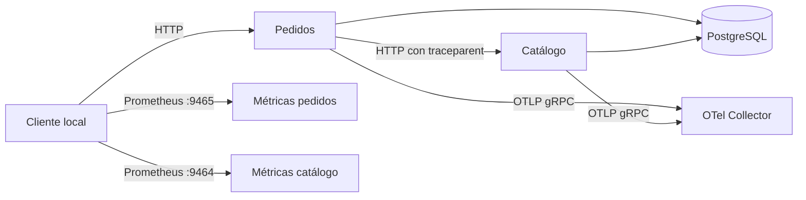

# ID-002 — Plan general: instrumentación OpenTelemetry local

## Identificación

| Campo | Detalle |
|---|---|
| ID | ID-002 |
| Título | Instrumentación OpenTelemetry de catálogo y pedidos. |
| Sprint / iteración | No documentado. |
| Prioridad | Alta |
| Estado global | Implementada sin validar |
| Sistemas y repositorios afectados | `services/catalog`, `services/orders`, `compose.yaml`, `docker/otel-collector`, `README.md`. |
| Iniciativas relacionadas | ID-001 — instrumenta los servicios definidos por ese plan. |

## Resumen de estado

La instrumentación, los endpoints de métricas y el Collector local quedaron incorporados. La validación automatizada y operativa está pendiente; no se declara la fase completada hasta que se compruebe Compose y la correlación de punta a punta.

## Enfoque técnico

Cada servicio configura su `TracerProvider` con `service.name` propio y exportador OTLP/gRPC. FastAPI, HTTPX en pedidos y SQLAlchemy se instrumentan con instrumentors OTel; las rutas de salud se excluyen. Los endpoints Prometheus usan `PrometheusMetricReader` en el puerto interno 9464. Los logs JSON incorporan el contexto span activo y conservan `request_id`.

## Contratos e interfaces afectados

| Elemento | Ubicación | Cambio | Compatibilidad hacia atrás |
|---|---|---|---|
| Endpoint Prometheus | `127.0.0.1:9464/metrics`, `127.0.0.1:9465/metrics` | Métricas HTTP de catálogo y pedidos. | Aditivo; API funcional no cambia. |
| Exportación OTLP | Red Compose, `otel-collector:4317` | Las APIs exportan trazas gRPC. | Interno al Compose. |
| Logs JSON | Middleware de cada servicio | Se agregan `trace_id` y `span_id`. | Aditivo; se conserva `request_id`. |
| Dependencias Python | `services/*/requirements.txt` | SDK, exportadores e instrumentors fijados. | Solo afecta imágenes de servicios. |

## Fases de ejecución

| Estado | # | Documento | Requisitos que cubre | Sistemas | Resultado esperado |
|---|---|---|---|---|---|
| Implementada sin validar | 1 | [Instrumentación OTel](01-instrumentacion-otel.md) | RF-001–RF-008, RNF-001–RNF-004 | APIs, Compose, Collector y README. | Trazas, métricas y logs correlacionados en entorno local. |

## Cobertura de requisitos

| Estado de cobertura | Requisito | Fase que lo cubre |
|---|---|---|
| Implementado sin validar | RF-001 | Fase 1 |
| Implementado sin validar | RF-002 | Fase 1 |
| Implementado sin validar | RF-003 | Fase 1 |
| Implementado sin validar | RF-004 | Fase 1 |
| Implementado sin validar | RF-005 | Fase 1 |
| Implementado sin validar | RF-006 | Fase 1 |
| Implementado sin validar | RF-007 | Fase 1 |
| Implementado sin validar | RF-008 | Fase 1 |
| Implementado sin validar | RNF-001 | Fase 1 |
| Implementado sin validar | RNF-002 | Fase 1 |
| Implementado sin validar | RNF-003 | Fase 1 |
| Implementado sin validar | RNF-004 | Fase 1 |

## Dependencias y orden de ejecución

La fase depende del código base de ID-001. La configuración y las dependencias OTel permiten instrumentar los engines al crearse; Compose inicia el Collector en la misma red. El Collector no bloquea el arranque de las APIs para que una indisponibilidad temporal de exportación no afecte solicitudes funcionales.

## Prerequisitos operativos

| Estado | Prerequisito | Tipo | Impacto si falta |
|---|---|---|---|
| Confirmado | Docker Compose v2 está instalado. | Infraestructura | Bloquea validación funcional. |
| Pendiente | Acceso al registro de imágenes para descargar Collector y dependencias Python. | Acceso | Bloquea build e integración. |
| Pendiente | Puertos locales 9464 y 9465 disponibles. | Configuración | Bloquea exposición de métricas. |
| No requerido | Cuenta cloud o backend externo de trazas. | Acceso | Ninguno; el Collector usa `debug`. |

## Riesgos y limitaciones

| Riesgo o limitación | Detalle | Impacto | Mitigación o decisión | Bloqueante |
|---|---|---|---|---|
| Prelanzamiento de instrumentors | Paquetes Python de instrumentación usan versiones beta. | Medio | Versiones fijadas y build/validación de imagen pendientes. | Para validar |
| Sin backend persistente de trazas | `debug` escribe trazas recibidas en logs del Collector. | Bajo | Adecuado para demostración local; no ofrece búsqueda histórica. | No |
| Métricas de DB fuera del alcance | SQLAlchemy se instrumenta para spans; las métricas cubren HTTP. | Bajo | Extender requisitos en otra iniciativa si se necesitan métricas DB. | No |

## Estrategia de validación

| Estado | Nivel | Qué cubre | Ejecución |
|---|---|---|---|
| Aprobada | Automatizada / estática | Sintaxis Python y resolución de Compose sin imprimir valores interpolados. | `python3 -m compileall -q services`; `docker compose config --quiet` |
| Pendiente de confirmación | Funcional / operativa | Métricas, exportación y correlación pedidos→catálogo→DB. | `docker compose up -d --build --wait`; ver instrucciones de fase 1. |
| Pendiente | Reversión y compatibilidad | APIs conservan contratos y cambios se revierten quitando Collector, providers y puertos. | Revisar smoke de API y eliminar bloque OTel de Compose/dependencias. |

## Criterios de cierre del plan

- [ ] RF-001 a RF-008 y RNF-001 a RNF-004 validados.
- [ ] Compose levanta APIs, PostgreSQL y Collector.
- [ ] Métricas consultables y spans correlacionados visibles en logs del Collector.
- [ ] No se exportan valores sensibles ni se cambian contratos funcionales.
- [ ] Gate 3 y Gate 4 completados con evidencia en fase e informe final.

## Referencias

- [`00-especificacion.md`](00-especificacion.md) — requisitos, casos y decisiones.
- [`01-instrumentacion-otel.md`](01-instrumentacion-otel.md) — instrucciones de implementación y validación.
- [OpenTelemetry Python exporters](https://opentelemetry.io/docs/languages/python/exporters/) y [Collector troubleshooting](https://opentelemetry.io/docs/collector/troubleshooting/).
