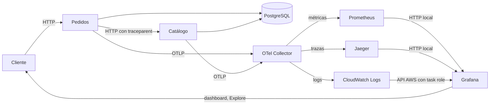

# ID-002 — Plan general: observabilidad local, ECS y visualización

## Identificación

| Campo | Detalle |
|---|---|
| ID | ID-002 |
| Título | Observabilidad OpenTelemetry local, ECS y visualización. |
| Sprint / iteración | No documentado. |
| Prioridad | Alta |
| Estado global | Fase 3 en despliegue: tag `phase3-test-4` publicado y revisión 8 de ECS en rollout. La validación UI del panel CPU, la correlación log→traza y la limpieza final siguen pendientes. |
| Sistemas y repositorios afectados | APIs, Docker Compose, Collector, Jaeger, Prometheus, Grafana, CloudWatch e IaC ECS. |
| Iniciativas relacionadas | ID-001 — instrumenta los servicios definidos por ese plan. |

## Resumen de estado

La revisión 8 de ECS está en rollout tras publicar `phase3-test-4`. El target del panel CPU ahora especifica explícitamente la fuente CloudWatch y los campos de consulta del editor. Explore devuelve datos, pero el Query Inspector del panel no recogía solicitud/respuesta; la corrección aún requiere confirmación de estabilidad y validación visual después del rollout. También quedan pendientes la evidencia log→traza en Jaeger y la destrucción de recursos al terminar.

## Enfoque técnico

Cada API configura su `TracerProvider` con `service.name` propio y exportador OTLP/gRPC. FastAPI, HTTPX en pedidos y SQLAlchemy se instrumentan con instrumentors OTel; las rutas de salud se excluyen. Cada API publica métricas HTTP Prometheus; los logs JSON conservan `request_id`, `trace_id` y `span_id`.

En ECS Fargate, la tarea `awsvpc` agrupa PostgreSQL, migraciones, APIs, OTel Collector, Jaeger, Prometheus y Grafana. El Collector recibe OTLP, envía trazas a Jaeger, métricas a Prometheus y logs a CloudWatch. Grafana se configura al iniciar desde archivos de provisioning, consulta Prometheus/Jaeger por `localhost` y accede a CloudWatch mediante el task role limitado a los grupos requeridos. El panel CPU consulta CloudWatch Metrics. No se agrega un backend de trazas externo al Jaeger ECS actual.

## Contratos e interfaces afectados

| Elemento | Ubicación | Cambio | Compatibilidad hacia atrás |
|---|---|---|---|
| Endpoint Prometheus | `127.0.0.1:9464/metrics`, `127.0.0.1:9465/metrics` | Métricas HTTP de catálogo y pedidos. | Aditivo; API funcional no cambia. |
| Exportación OTLP | Red ECS, puertos 4317/4318 | Las APIs exportan telemetría al Collector. | Interno al despliegue. |
| ECS Terraform | `infra/otel-ecs-lab` y `infra/tf_modules` | Agrega imagen/contenedor Grafana, puerto 3000 y permisos/secretos acotados; aumenta memoria de tarea a 3 GiB. | Requiere actualizar ECR y task definition. |
| Datasources Grafana | `docker/grafana/provisioning/datasources/` | Prometheus, Jaeger y CloudWatch. | Aditivo a backends existentes. |
| Dashboard | `docker/grafana/dashboards/` | Seis paneles con cuatro SLIs, CPU y errores del Collector. | Aditivo; configuración reproducible. |
| Correlación de logs | CloudWatch Logs y Grafana Explore | El `trace_id` de un evento guía la búsqueda TraceID en Jaeger. | No cambia formato de API. |

## Fases de ejecución

| Estado | # | Documento | Requisitos que cubre | Sistemas | Resultado esperado |
|---|---|---|---|---|---|
| Implementada sin validar | 1 | [Instrumentación OTel](01-instrumentacion-otel.md) | RF-001–RF-008, RNF-001–RNF-004 | APIs, Compose y Collector local. | Trazas, métricas y logs locales correlacionados. |
| Implementada sin validar | 2 | [Despliegue ECS](02-despliegue-ecs.md) | RF-009–RF-017, RNF-005–RNF-007 | Collector, APIs, Jaeger, Prometheus, CloudWatch y Terraform. | Laboratorio ECS operativo para consultas y smoke tests. |
| Rollout en curso; UI pendiente | 3 | [Visualización y correlación en ECS](03-visualizacion-grafana.md) | RF-018–RF-022, RNF-008–RNF-009; revalidación de RF-002, RF-011–RF-013 y RF-019. | Grafana, CloudWatch, Jaeger, Prometheus, ECS y Terraform. | Dashboard con seis paneles y recorrido reproducible log→traza. |
| Implementada; mediciones pendientes | 4 | [Análisis de overhead](04-analisis-overhead.md) | RF-023, RNF-010. | Toggle `OTEL_ENABLED`, runner de Compose/k6 y recolección de Docker stats listos; falta ejecutar en un host con k6. | Comparación reproducible de p99, CPU y memoria con OTel activado/desactivado; sin resultados hasta ejecutar las corridas. |

## Cobertura de requisitos

| Estado de cobertura | Requisito | Fase que lo cubre |
|---|---|---|
| Implementado, funcional pendiente | RF-001 | Fase 1 |
| Implementado, funcional pendiente | RF-002 | Fase 1 y validación extremo a extremo en fase 3 |
| Implementado, funcional pendiente | RF-003 | Fase 1 y validación extremo a extremo en fase 3 |
| Implementado, funcional pendiente | RF-004 | Fase 1 |
| Implementado, funcional pendiente | RF-005 | Fase 1 y dashboard fase 3 |
| Implementado, funcional pendiente | RF-006 | Fase 1 y consulta de logs fase 3 |
| Implementado, funcional pendiente | RF-007 | Fase 1 |
| Implementado, funcional pendiente | RF-008 | Fase 1 |
| Implementado; pipeline cloud por confirmar | RF-009 | Fase 2 |
| Implementado; pipeline cloud por confirmar | RF-010 | Fase 2 |
| Implementado; visualización por confirmar | RF-011 | Fase 2 y 3 |
| Implementado; visualización por confirmar | RF-012 | Fase 2 y 3 |
| Implementado; consulta por confirmar | RF-013 | Fase 2 y 3 |
| Implementado; recursos desplegados | RF-014 | Fase 2 y 3 |
| Implementado; flujo de pedido por confirmar | RF-015 | Fase 2 y 3 |
| Implementado; seguridad de Grafana pendiente | RF-016 | Fase 2 y 3 |
| Despliegue activo; limpieza pendiente | RF-017 | Fase 2 y 3 |
| Implementado; verificación funcional pendiente | RF-018 | Fase 3 |
| Implementado; verificación end-to-end pendiente | RF-019 | Fase 3 |
| Implementado; verificación funcional pendiente | RF-020 | Fase 3 |
| Implementado; correlación log→traza pendiente | RF-021 | Fase 3 |
| Implementado; verificación de red pendiente | RF-022 | Fase 3 |
| Implementado; mediciones pendientes | RF-023 | Fase 4 |
| Implementado; verificar permisos efectivos | RNF-008 | Fase 3 |
| Implementado; arranque/reaprovisionamiento pendientes de verificar | RNF-009 | Fase 3 |
| Implementado, funcional pendiente | RNF-001–RNF-004 | Fase 1 |
| Implementado, AWS por confirmar | RNF-005–RNF-007 | Fase 2 |
| Implementado; corridas/evidencia pendientes | RNF-010 | Fase 4 |

## Dependencias y orden de ejecución

La fase 1 depende del código base de ID-001. La fase 2 depende de la instrumentación, las imágenes publicadas y permisos de creación AWS. La fase 3 depende del ECS activo, de confirmar nombres/labels reales en Prometheus y de disponer de permisos para extender el repositorio IaC, ECR, IAM, Secrets Manager, CloudWatch y ECS. Las tareas de imagen/provisioning Grafana y consultas del dashboard pueden avanzar en paralelo; el apply y las pruebas funcionales requieren que ambas estén listas. La fase 4 depende de contar con Docker Compose/k6 local, datos semilla y una opción `OTEL_ENABLED` que permita alternar providers e instrumentación sin variar la aplicación funcional; la especificación está en [`04-analisis-overhead.md`](04-analisis-overhead.md).

## Prerequisitos operativos

| Estado | Prerequisito | Tipo | Impacto si falta |
|---|---|---|---|
| Confirmado | Docker Compose v2 y proyecto local disponibles. | Infraestructura | Bloquea validación local. |
| Confirmado | Cuenta AWS, región `us-east-1`, ECS/ECR y entorno de fase 2. | Acceso/infraestructura | Bloquea el smoke test AWS. |
| Confirmado | La infraestructura Terraform reside en `infra/otel-ecs-lab` y los módulos en `infra/tf_modules`, dentro de este repositorio. | Repositorio | Ninguno. |
| Confirmado | CIDR de prueba `181.61.246.55/32`. | Configuración | Bloquea el acceso web a Grafana. |
| Implementado en IaC | Aprovisionar el secreto de administrador Grafana y permiso de lectura CloudWatch acotado. | Seguridad | Requiere apply para estar activo. |
| En rollout | Publicar `phase3-test-4` y desplegar la revisión 8 de la task definition. | ECR/ECS | Confirmar rollout estable y validar el panel CPU en la UI. |
| No requerido | GCP, X-Ray, Tempo, servicio Grafana gestionado. | Alcance | Ninguno; están fuera de alcance. |

## Riesgos y limitaciones

| Riesgo o limitación | Detalle | Impacto | Mitigación o decisión | Bloqueante |
|---|---|---|---|---|
| Instrumentors preliminares | Dependencias Python fijadas incluyen componentes beta. | Medio | Mantener versiones fijadas y completar build/smoke. | Para validar |
| Trazas/datos efímeros | Jaeger y datos locales de Grafana viven en almacenamiento efímero. | Medio | Provisionar de nuevo desde archivos y exportar evidencia antes de destruir. | No |
| Compatibilidad de métricas | El nombre de métrica/atributos cambia según semconv/exporter. | Medio | Validar contra Prometheus real antes de fijar PromQL. | Para dashboard |
| Memoria Fargate | Grafana agrega consumo a una tarea actual de 2 GiB. | Medio | Dimensionar a 1 vCPU/3 GiB para la prueba y revisar estabilidad; el costo sube mientras esté activa. | Para deploy |
| Rol compartido de tarea | Las credenciales IAM del task role están disponibles a todos los contenedores. | Medio | Limitar lectura a métricas y grupos de log requeridos, sin permisos de escritura desde Grafana. | No |
| Error de métrica Collector | Los logs recientes notifican labels duplicadas en `pipeline_up`. | Medio | Mostrar el evento en el panel, investigar recurrencia y no filtrar el error para ocultarlo. | No |
| Acceso al puerto Grafana | El contenedor expone interfaz administrativa. | Alto | CIDR explícito, contraseña desde Secrets Manager, sin `0.0.0.0/0`. | Para deploy |

## Estrategia de validación

| Estado | Nivel | Qué cubre | Ejecución |
|---|---|---|---|
| Aprobada en entorno local | Automatizada / estática | JSON del dashboard, Python, Compose, formato Terraform, init, validate y plan. | Las consultas CloudWatch/Prometheus requieren validación después del despliegue. |
| Aprobada en entorno local | Automatizada / imagen | Build de Grafana y carga de provisioning. | Docker build correcto; API local confirmó seis paneles y datasources Prometheus, Jaeger y CloudWatch. |
| Parcialmente confirmada | Funcional / operativa | Tag `phase3-test-4` publicado y revisión 8 en rollout; Explore consulta datos pero el panel CPU aún no se ha validado en UI. | Confirmar estabilidad; revisar Query Inspector y renderizado del dashboard, y completar correlación log→traza. |
| Plan revisado; runtime pendiente | Seguridad | CIDR, secreto y alcance IAM. | El plan conserva el CIDR `181.61.246.55/32`; verificar acceso y permisos efectivos tras el apply. |
| Pendiente | Reversión y limpieza | Recursos del laboratorio. | Guardar evidencia; `terraform destroy`; confirmar servicio sin tareas. |

## Criterios de cierre del plan

- [ ] RF-001 a RF-022 y RNF-001 a RNF-009 validados o con limitación explícita aceptada.
- [x] Toggle OTel, escenario k6 y runner local implementados para RF-023/RNF-010.
- [ ] Ejecutar al menos tres rondas válidas por variante y adjuntar las evidencias; hasta entonces la fase 4 queda pendiente de medición.
- [ ] Dashboard Grafana con exactamente seis paneles y series no vacías para los casos generados.
- [ ] Misma traza pedidos→catálogo→PostgreSQL visible en Jaeger y localizable desde `trace_id` en Grafana Explore.
- [ ] Log de aplicación consultable en Grafana vía CloudWatch Logs.
- [ ] Puerto 3000 solo accesible desde el CIDR autorizado y contraseña fuera de archivos versionados.
- [ ] Terraform destruido o decisión documentada de mantener el entorno activo, con su impacto de costo.
- [ ] Gates 3 y 4 completados con evidencia en fase e informe final.

## Referencias

- [`00-especificacion.md`](00-especificacion.md) — requisitos, casos y decisiones.
- [`01-instrumentacion-otel.md`](01-instrumentacion-otel.md) — instrumentación y validación local.
- [`02-despliegue-ecs.md`](02-despliegue-ecs.md) — laboratorio ECS.
- [`03-visualizacion-grafana.md`](03-visualizacion-grafana.md) — fase de dashboard, correlación y evidencias.
- [`04-analisis-overhead.md`](04-analisis-overhead.md) — protocolo y evidencias de la medición de overhead.
- [Grafana provisioning](https://grafana.com/docs/grafana/latest/administration/provisioning/) y [datasource Jaeger](https://grafana.com/docs/grafana/latest/datasources/jaeger/query-editor/).
- [Grafana CloudWatch query editor](https://grafana.com/docs/grafana/latest/datasources/aws-cloudwatch/query-editor/) y [AWS ECS service utilization](https://docs.aws.amazon.com/AmazonECS/latest/developerguide/service_utilization.html).
