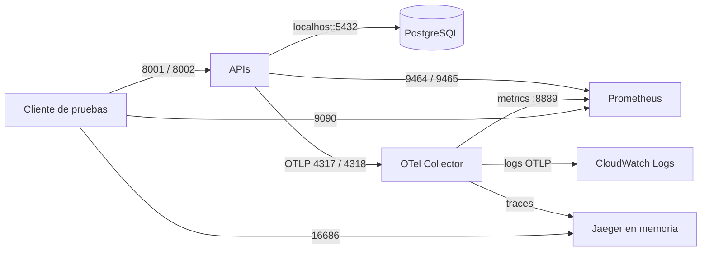

# ID-002 — Fase 2: Despliegue mínimo en ECS Fargate

## Identificación

| Campo | Detalle |
|---|---|
| Plan | ID-002 — Observabilidad OpenTelemetry de catálogo y pedidos. |
| Fase | 2 — Collector y despliegue ECS |
| Estado | Implementada sin validar en AWS |
| Requisitos | RF-009–RF-017, RNF-005–RNF-007 |
| Dependencias | Fase 1; cuenta AWS, Terraform, Docker y permiso para escribir en el repositorio de infraestructura. |
| Región | `us-east-1` |

## Objetivo

Desplegar un entorno efímero que permita probar el pipeline completo en una tarea ECS Fargate: dos APIs, PostgreSQL, migraciones, OTel Collector, Jaeger y Prometheus. El Collector recibirá OTLP/gRPC y OTLP/HTTP; enviará trazas a Jaeger, métricas a Prometheus y logs estructurados a CloudWatch Logs.

## Diseño

Fargate usa `awsvpc`; los contenedores de una tarea comparten `localhost`. Catálogo escucha en 8001 y pedidos en 8002. Las migraciones arrancan después de que PostgreSQL está saludable; las APIs esperan migraciones exitosas, y pedidos espera catálogo. PostgreSQL y Jaeger no tienen volúmenes persistentes. El Collector scrapea los endpoints de métricas de ambas APIs; Prometheus scrapea la salida Prometheus del Collector.

Terraform crea una VPC con dos subredes públicas, Internet Gateway y sin NAT Gateway. La tarea recibe IP pública. El security group admite desde `allowed_cidr` solamente 8001, 8002, 4317, 4318, 16686 y 9090. PostgreSQL, métricas y la salud del Collector quedan accesibles solo dentro de la tarea. La variable no admite `0.0.0.0/0`.

Las credenciales se generan con `random_password`, quedan en Secrets Manager y se inyectan como campos JSON. El task execution role descarga imágenes, escribe logs de contenedor y lee el secreto. El task role tiene permisos de escritura limitados al log group de OTel. Los dos grupos CloudWatch retienen un día.

## Imágenes y configuración

| Imagen | Origen |
|---|---|
| `catalog`, `orders` | Dockerfiles existentes de los servicios. |
| `postgres` | `docker/postgres/Dockerfile`, incluye inicialización de roles/esquemas. |
| `otel-collector` | Collector Contrib 0.163.0 con `docker/otel-collector/ecs.yaml`. |
| `jaeger` | Jaeger 2.22.0 con almacenamiento en memoria y UI. |
| `prometheus` | Prometheus 3.13.3 LTS; scrapea la salida del Collector. |

Terraform crea un ECR por imagen con tags inmutables. `scripts/push-ecs-images.py` construye y publica los tags con contexto en la raíz del proyecto. El root IaC está en [`/home/ajfuq/projects/infraestructura/infra/otel-ecs-lab`](</home/ajfuq/projects/infraestructura/infra/otel-ecs-lab/README.md>), dentro del repositorio de infraestructura.

## Tareas

| Estado | Tarea | Criterio |
|---|---|---|
| [x] | Configurar OTLP/gRPC + HTTP, processors y pipelines locales. | Collector local acepta OTLP y deja las tres señales en `debug`. |
| [x] | Exportar logs JSON de cada API mediante OTel Logs además de stdout. | Los eventos del middleware se envían por OTLP y conservan contexto trace/span. |
| [x] | Crear Collector ECS, Jaeger, Prometheus y configuración de PostgreSQL. | Los contenedores auxiliares tienen versiones fijadas y config versionada. |
| [x] | Crear root Terraform, permisos, ECR, red y tarea Fargate. | Manifiestos definen los recursos mínimos y `allowed_cidr` obligatorio. |
| [x] | Documentar publicación, smoke test y limpieza. | README Terraform tiene los pasos reproducibles. |
| [x] | Formatear los manifiestos Terraform. | `terraform fmt -check -recursive` termina correctamente. |
| [ ] | Inicializar providers y validar el plan local de Terraform. | `terraform init -backend=false` y `terraform validate` terminan correctamente. |
| [ ] | Publicar imágenes y aplicar en una cuenta de prueba. | Tarea saludable, migraciones completas y endpoints accesibles desde CIDR permitido. |
| [ ] | Verificar trazas, métricas y logs extremo a extremo. | Jaeger, Prometheus y CloudWatch muestran eventos del test. |
| [ ] | Destruir el laboratorio. | No queda servicio ECS ejecutándose. |

## Procedimiento de prueba

1. Configurar `allowed_cidr` con el CIDR público que ejecutará las pruebas; usar el archivo `terraform.tfvars.example` como base.
2. Inicializar Terraform y aplicar el target `aws_ecr_repository.images` para crear ECR.
3. Ejecutar `scripts/push-ecs-images.py`, que autentica Docker en ECR y publica las imágenes.
4. Aplicar Terraform. Revisar estado de contenedores y logs de las migraciones antes de llamar a las APIs.
5. Crear un producto en `:8001`, crear pedido en `:8002`, y verificar el mismo `trace_id` en Jaeger.
6. Consultar en Prometheus las series scrapeadas desde los endpoints internos `/metrics` de ambas APIs.
7. Verificar CloudWatch `/pipeline-otel/ecs-test` y eventos JSON correlacionados.
8. Ejecutar `terraform destroy` al finalizar.

La URL/IP pública se obtiene desde el attachment de red de la tarea ECS. No se crea balanceador para esta prueba.

## Validación registrada

El código y los manifiestos están implementados. `terraform fmt -check -recursive`, Python AST, Compose y la sintaxis del script PostgreSQL pasaron. `terraform init -backend=false` no pudo descargar los providers porque el runtime no resuelve `registry.terraform.io`; por eso `terraform validate` no se ejecutó. No se aplicó Terraform, no se publicaron imágenes y no hubo prueba AWS. La ejecución cloud requiere cuenta/permisos AWS y escritura en el directorio de infraestructura separado; el daemon Docker tampoco está disponible en este runtime.

## Riesgos

| Riesgo | Mitigación |
|---|---|
| PostgreSQL/Jaeger efímeros | Usar solo datos de prueba; destruir al finalizar. |
| Task pública | Restringir cada puerto expuesto a `allowed_cidr`; ninguna regla permite el CIDR global. |
| Estado Terraform contiene contraseñas | Mantener estado local protegido y borrarlo al destruir la prueba. |
| Consumo limitado de memoria | La tarea tiene 1 vCPU y 2 GiB; el diseño es para baja carga y un smoke test. |
| Imagen o config auxiliar inválida | Ejecutar build/arranque en Docker antes de aplicar y verificar estado ECS. |

## Cierre de fase

- Resultado: implementación preparada; validación local/cloud pendiente.
- Sin despliegue de recursos AWS durante la generación de este documento.
- Gate de implementación cubierto; gate funcional y destrucción se completan tras ejecutar la prueba AWS.
