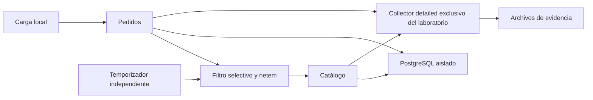

# ID-003 — Plan general: Game Day de caos local

## Identificación

| Campo | Detalle |
|---|---|
| **ID** | ID-003 |
| **Título** | Game Day de caos local |
| **Sprint / iteración** | No documentado |
| **Prioridad** | Media |
| **Estado global** | En implementación: diseño completado; fases 2 y 3 implementadas sin validar |
| **Sistemas y repositorios afectados** | Proyecto actual; laboratorio Compose local independiente |
| **Iniciativas relacionadas** | ID-001 e ID-002 como base técnica |

## Resumen de estado

La fase 1 queda completada mediante diseño documental y revisión estática. La fase 2 entrega manifiesto aislado, CLI, supervisor independiente y carga. La fase 3 añade Collector detallado exclusivo, captura Prometheus, correlación y análisis offline. La suite conjunta aprueba 90 pruebas unitarias en 2,122 s; también se verifican sintaxis AST de once archivos, ayuda CLI y Compose normalizado sin daemon. Las fases 2 y 3 permanecen Implementadas sin validar: no se han ejecutado builds, servicios ni experimentos. Las fases 4–5, los resultados reales, las capturas manuales y el PDF permanecen pendientes. Los Gates 3 de fases 2 y 3 conservan los pendientes operativos.

## Enfoque técnico

El manifiesto autónomo `compose.chaos.yaml` reutiliza los Dockerfiles y servicios actuales, con proyecto `chaos-<run-id>`, volumen PostgreSQL propio, credenciales privadas no impresas y puertos loopback asignados dinámicamente. La configuración privada se escribe en `.chaos/<run-id>/env`, separada de los metadatos saneados de `artifacts/chaos/<run-id>/`. El Compose habitual y las aplicaciones conservan sus contratos.

Un auxiliar con `network_mode: service:orders`, usuario root y `NET_ADMIN` instalará únicamente sus reglas selectivas sobre el espacio de red de pedidos. No tendrá modo host, contenedor privilegiado ni montaje del socket Docker. La red compartida está documentada por [Docker Compose](https://docs.docker.com/compose/how-tos/networking/); su disponibilidad concreta requiere preflight local.

Aplicar netem solo a IPv4 destino catálogo y puerto TCP 8000, en salida de pedidos. Configurar el laboratorio para ese camino IPv4 y resolver la dirección antes de cada corrida. Un retraso de 6000 ms afecta paquetes, no equivale a sumar exactamente seis segundos por solicitud; el efecto real depende de conexiones y kernel, como advierte [tc-netem](https://man7.org/linux/man-pages/man8/tc-netem.8.html).

La carga implementada cubre creación de pedidos y dos lecturas de control. El supervisor PID 1 recibe órdenes mediante un socket UNIX interno, mantiene TTL de sesenta segundos y concesión de diez segundos, sin socket Docker montado. La fase 3 añade métricas crudas cada cinco segundos por servicio, logs acotados y Collector `detailed` exclusivo, con batch de un segundo y margen adicional de exportación de doce segundos. No se presupone entrega completa: las trazas requeridas ausentes hacen inconclusa la evaluación. El análisis offline valida evidencia y calcula indicadores sin Jaeger, Grafana ni Prometheus servidor. La clasificación se limita a IPv4 TCP sin fragmentación y cabecera IPv4 de veinte bytes; se rechaza IPv6. Los límites IPC del host y el registro de retirada del supervisor permiten separar dominios monotónicos con incertidumbre conservadora.

## Contratos e interfaces afectados

El laboratorio, CLI, captura y análisis están implementados en fases 2 y 3; el informe de resultados continúa pendiente de fase 5. La operación y evidencia real siguen pendientes.

| Elemento | Ubicación | Cambio | Compatibilidad hacia atrás |
|---|---|---|---|
| Laboratorio | `compose.chaos.yaml` | Topología aislada y puertos loopback dinámicos | Compatible; Compose habitual intacto |
| Operación | `scripts/chaos/run.py` | Subcomandos prepare, run, rollback, status y down con `--run-id` | Interfaz nueva |
| Análisis | `scripts/chaos/check_evidence.py`, `analyze.py` y futuro `report.py` | Verificador JSON de solo lectura; analizador genera summary.json; results.md reservado a fase 5 | Interfaces nuevas; análisis offline |
| Evidencia | `artifacts/chaos/<run-id>/` | Formato versión 2: metadatos saneados, eventos, solicitudes, métricas crudas indexadas, logs y summary.json; results.md pendiente | Corridas de formato anterior no se aceptan como evidencia completa sin datos requeridos |
| Contratos de negocio | APIs y PostgreSQL existentes | Sin cambios de respuesta, migración o timeout | Compatible |

`run-id` será un identificador de 1–32 caracteres ASCII minúsculos, dígitos y guiones, empezando y terminando con carácter alfanumérico. Se rechazará reutilizar un identificador existente para preparar una nueva corrida. Las herramientas verificarán identidad del proyecto y etiquetas de ejecución antes de operar.

### Contrato común transferido desde fase 1

Las fases 2–4 implementarán las ventanas como intervalos semiabiertos y conservarán los intentos que crucen límites como transición, sin excluirlos del conteo global. La ventana estable de E1 empieza diez segundos después de activación confirmada y termina en la retirada; exige treinta intentos elegibles iniciados y terminados dentro de ella. Deben ser `504 catalog_timeout` al menos el 95 % de esos intentos, y durar 4,5–6,5 s al menos el 95 % de esas respuestas 504. Menos muestras, denominador cero, omisión de carga o efecto del fallo no demostrado impiden aceptar la hipótesis.

Un error HTTP o de transporte en un GET de control o un fallo de liveness activa aborto inmediato. El p95 de cada lectura de control se evalúa acumulativamente por ventana desde veinte muestras; un valor >=1 s activa aborto. Readiness y liveness se sondean independientemente cada cinco segundos con timeout de ocho segundos. Readiness 503 durante la inyección no activa aborto; se conserva como impacto. Las discrepancias de persistencia detectadas, destino cambiado o retirada no garantizada también activan aborto.

La retirada con infraestructura operativa debe comprobarse antes de cinco segundos después del TTL. El supervisor independiente usa concesión de diez segundos; si desaparece la renovación del runner, debe limpiar antes de quince segundos desde la última renovación. El fallo del auxiliar o daemon obliga a declarar resultado inconcluso y a comprobar limpieza antes de reutilizar el laboratorio. Estos plazos son criterios a validar, no capacidades demostradas.

Los códigos `error.code` proceden de las respuestas del generador; los logs actuales aportan request_id, estado HTTP, duración y contexto de traza cuando existe. No se presupone error.code en los logs ni span servidor de catálogo cuando la solicitud no llega. La fase 3 verifica correlación de logs con span cliente y padre de negocio; un formato debug desconocido produce evidencia incompleta. La salida cero del verificador indica integridad, incluso con hipótesis refutada; la salida uno señala evidencia incompleta o inconsistente. Los fixtures sintéticos viven solo en temporales y nunca validan una corrida real.

## Fases de ejecución

| Estado | # | Documento | Requisitos que cubre | Sistemas | Resultado esperado |
|---|---|---|---|---|---|
| Completada | 1 | [Diseño](01-diseno-gameday.md) | RF-001, RF-002, RF-003; RNF-001, RNF-002, RNF-004 | Game Day | Hipótesis, SLI, fichas, aborto y reversión revisados documentalmente |
| Implementada sin validar | 2 | [Harness](02-harness-caos-local.md) | RF-002, RF-004; RNF-001, RNF-002, RNF-003, RNF-004 | Compose y auxiliar | Manifiesto, CLI, supervisor y carga implementados; operación pendiente |
| Implementada sin validar | 3 | [Observabilidad y pruebas](03-observabilidad-y-pruebas-locales.md) | RF-003; RNF-003, RNF-004, RNF-005 | Captura y análisis | Captura, correlación y análisis offline implementados; corrida real pendiente |
| Pendiente | 4 | [Ejecución y análisis](04-ejecucion-y-analisis.md) | RF-004, RF-005, RF-006, RF-007; RNF-001, RNF-002, RNF-003, RNF-004, RNF-005 | Laboratorio local | Una corrida real y recuperación confirmadas |
| Pendiente | 5 | [Entregable](05-entregable-gameday.md) | RF-008, RF-009; RNF-004, RNF-005 | Informe | Markdown respaldado por evidencia; PDF diferido |

## Cobertura de requisitos

| Estado de cobertura | Requisito | Fase que lo cubre |
|---|---|---|
| Cumplido y validado documentalmente: formulación de hipótesis | RF-001 | 1 |
| Diseño validado; harness implementado sin validación operativa | RF-002 | 1, 2 |
| Definición validada; captura y verificación implementadas sin validación operativa | RF-003 | 1, 3 |
| Harness implementado; ejecución y confirmación pendientes | RF-004 | 2, 4 |
| Pendiente | RF-005 | 4 |
| Pendiente | RF-006 | 4 |
| Pendiente | RF-007 | 4 |
| Pendiente de informe con resultados | RF-008 | 5 |
| Diferido; no cumplido en entrega actual | RF-009 | 5 |
| Aislamiento implementado; pendiente de validación operativa | RNF-001 | 1, 2, 4 |
| Supervisor y limpieza implementados; pendiente de validación operativa | RNF-002 | 1, 2, 4 |
| Credenciales, volumen y captura aislados implementados; validación operativa pendiente | RNF-003 | 2, 3, 4 |
| CLI, captura y análisis reproducible implementados; corrida pendiente | RNF-004 | 1–5 |
| Procedimiento y pruebas locales implementados; ejecución operativa pendiente | RNF-005 | 3–5 |

## Dependencias y orden de ejecución

La fase 1 fija hipótesis, SLI y criterios de aborto y queda validada documentalmente. Los Gates 1 y 2 cuentan con revisión documental en la fase 1; las capacidades y los límites del laboratorio siguen sujetos a preflight y a la implementación de fase 2. Las fases 2 y 3 pueden avanzar en paralelo conforme a los formatos de evidencia y comandos de este plan. La fase 4 requiere ambas, sus pruebas unitarias aprobadas y preflight operativo confirmado. La fase 5 puede preparar la estructura en paralelo, pero solo incorpora conclusiones tras la fase 4. La actualización documental se delega en paralelo durante la implementación y se revisa antes de cada cierre.

La validación estática cierra exclusivamente la fase 1, cuyo entregable es diseño. No cierra las fases de ejecución. Para estas corresponde `Implementada sin validar` cuando reste confirmación operativa, y `Completada` después de confirmar la evidencia requerida.

## Prerequisitos operativos

| Estado | Prerequisito | Tipo | Impacto si falta |
|---|---|---|---|
| Confirmado por inspección local | Python 3 y cliente Docker disponibles | Infraestructura | Permite preparar documentación, no prueba daemon |
| Pendiente | Daemon Docker local operativo; Compose v2 y capacidad NET_ADMIN/netem | Infraestructura | Bloquea fases 2 y 4 operativas |
| Pendiente | Imágenes y dependencias disponibles para build local | Infraestructura | Bloquea arranque; descargas requieren autorización aplicable |
| Pendiente | Recursos para baseline y puertos loopback dinámicos | Infraestructura | Bloquea inyección si baseline no cumple |
| No requerido | Credenciales o recursos de nube | Acceso | Fuera de alcance |
| Pendiente | Ejecución manual y confirmación de resultados | Decisión | Impide validar fases operativas |
| Diferido | Producción del PDF original | Decisión | Impide declarar cumplimiento integral de RF-009 |

## Riesgos y limitaciones

| Riesgo o limitación | Detalle | Impacto | Mitigación o decisión | Bloqueante |
|---|---|---|---|---|
| netem no disponible | Cliente Docker no demuestra capacidades del daemon | Alto | Preflight manual sin alterar red del host; detener si falla | Sí para ejecución |
| Reglas ajenas | Sustituir qdisc existente ampliaría el impacto | Alto | Rechazar reglas administradas ajenas; retirar solo handles propios | Sí si se detecta |
| Terminación abrupta | El generador puede desaparecer | Alto | Watchdog independiente, TTL y limpieza idempotente | Sí sin prueba de reversión |
| Fallo de daemon o auxiliar | El temporizador tampoco sobrevive a toda pérdida de infraestructura | Alto | No prometer garantía absoluta; cuarentena y limpieza comprobada antes de reutilizar | Sí hasta limpieza |
| Límites de aislamiento sin probar operativamente | Selección IPv4/TCP, identidad y watchdog implementados; comportamiento real de red aún sin comprobar | Alto | Registrar pruebas locales y validar manualmente filtros, identidad, TTL y límites antes de aceptar una inyección | Sí para ejecución |
| Ruido y ventanas cortas | Hardware local y número de muestras limitan inferencias | Medio | Conservar todas las muestras y umbrales de laboratorio | No |
| Trazas incompletas | No siempre llegará una petición al servidor catálogo | Medio | Span cliente y log de pedidos; confirmar exportación tras drenaje | Sí para cierre si evidencia requerida falta |
| Remediación sin causalidad | Un umbral incumplido no identifica por sí solo la causa | Medio | Distinguir observación, hipótesis causal y propuesta | No |
| PDF diferido | Markdown no satisface formato original | Medio | Registrar RF-009 pendiente | Sí para cierre integral |

## Estrategia de validación

| Estado | Nivel | Qué cubre | Ejecución |
|---|---|---|---|
| Aprobada para fase 1 | Estática documental | Hipótesis, SLI, evidencia del código actual, políticas de aborto, Gates 1–2 y coherencia documental | Local, sin servicios; cierra diseño y Gate 3 de fase 1, no valida el laboratorio |
| Aprobada para fase 2: 50 pruebas en 1,008 s | Automatizada | Harness, filtros y watchdog con dobles; cálculo avanzado de SLI pendiente de fase 3 | `python3 -m unittest discover -s tests/chaos -p 'test_*.py'` |
| Aprobada para fase 2 | Estática Compose | Sintaxis e interpolación del manifiesto con valores ficticios, sin daemon | `config --quiet`; comando completo en fase 2 |
| Pendiente de confirmación | Funcional / operativa | Build, baseline, inyección y recuperación reales | Manual; comandos de fase 4 |
| Pendiente de confirmación | Reversión | TTL, aborto, interrupción y ausencia de reglas propias | Manual; fase 2 |
| Aprobada localmente; operación pendiente | Evidencia | Integridad, indicadores y correlación en fixtures temporales; suite conjunta de 90 pruebas en 2,122 s; evidencia real pendiente | Unitarias; luego `python3 scripts/chaos/check_evidence.py artifacts/chaos/ID` y `python3 scripts/chaos/analyze.py artifacts/chaos/ID` sobre corrida real |

## Criterios de cierre del plan

- [ ] Cinco fases completadas con sus validaciones confirmadas.
- [ ] RF-001 a RF-008 y RNF-001 a RNF-005 respaldados por evidencia.
- [ ] RF-009 satisfecho mediante PDF de 4–5 páginas; mientras esté diferido solo cabe entrega parcial explícita.
- [ ] Pruebas automatizadas aprobadas y validación operativa confirmada.
- [ ] Sin reglas de caos activas ni riesgos de limpieza abiertos.
- [ ] Sin aclaraciones abiertas y con decisiones actualizadas.
- [x] Gate 3 de fase 1 ejecutado con evidencia documental y pendientes transferidos a fases 2–3.
- [ ] Gates 3 de fases 2–5 y Gate 4 integral ejecutados; informe actualizado con resultados reales.

## Referencias

- [Especificación](00-especificacion.md), [guía](../GUIA-AGENTE.md) y [constitución](../CONSTITUCION.md).
- [Compose actual](../../compose.yaml), [Collector actual](../../docker/otel-collector/config.yaml) y [README](../../README.md).
- [OpenTelemetry debug detallado](https://opentelemetry.io/docs/collector/troubleshooting/), consultado el 2026-10-16.
