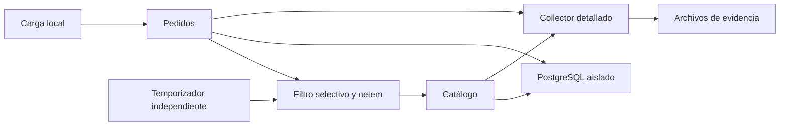

# ID-003 — Plan general: Game Day de caos local

## Identificación

| Campo | Detalle |
|---|---|
| **ID** | ID-003 |
| **Título** | Game Day de caos local |
| **Sprint / iteración** | No documentado |
| **Prioridad** | Media |
| **Estado global** | En análisis: documentación preparada, implementación pendiente |
| **Sistemas y repositorios afectados** | Proyecto actual; laboratorio Compose local independiente |
| **Iniciativas relacionadas** | ID-001 e ID-002 como base técnica |

## Resumen de estado

Se dispone de especificación, diseño y fases de implementación en Markdown. No se ha implementado el harness, ejecutado el experimento ni obtenido resultados reales. Las cinco fases permanecen pendientes; capturas manuales y PDF también quedan pendientes.

## Enfoque técnico

Reutilizar los Dockerfiles y servicios actuales mediante un manifiesto autónomo futuro `compose.chaos.yaml`, para evitar la combinación accidental de puertos y volúmenes de la instancia cotidiana. Cada ejecución tendrá proyecto `chaos-<run-id>`, volumen PostgreSQL propio, credenciales efímeras no impresas y puertos loopback asignados dinámicamente. No se modificarán `compose.yaml` ni las aplicaciones.

Un auxiliar con `network_mode: service:orders`, usuario root y `NET_ADMIN` instalará únicamente sus reglas selectivas sobre el espacio de red de pedidos. No tendrá modo host, contenedor privilegiado ni montaje del socket Docker. La red compartida está documentada por [Docker Compose](https://docs.docker.com/compose/how-tos/networking/); su disponibilidad concreta requiere preflight local.

Aplicar netem solo a IPv4 destino catálogo y puerto TCP 8000, en salida de pedidos. Configurar el laboratorio para ese camino IPv4 y resolver la dirección antes de cada corrida. Un retraso de 6000 ms afecta paquetes, no equivale a sumar exactamente seis segundos por solicitud; el efecto real depende de conexiones y kernel, como advierte [tc-netem](https://man7.org/linux/man-pages/man8/tc-netem.8.html).

La carga cubrirá creación de pedidos y dos lecturas de control. El Collector usará una configuración exclusiva del laboratorio con `debug` detallado; sus logs se guardarán como evidencia, sin introducir Jaeger, Grafana ni Prometheus servidor.

## Contratos e interfaces afectados

Las rutas siguientes son propuestas para implementación futura; no existen por esta entrega documental.

| Elemento | Ubicación | Cambio | Compatibilidad hacia atrás |
|---|---|---|---|
| Laboratorio | `compose.chaos.yaml` | Topología aislada y puertos loopback dinámicos | Compatible; Compose habitual intacto |
| Operación | `scripts/chaos/run.py` | Subcomandos prepare, run, rollback, status y down con `--run-id` | Interfaz nueva |
| Análisis | `scripts/chaos/check_evidence.py` y `scripts/chaos/report.py` | Verificar evidencia y generar results.md desde directorio de corrida | Interfaces nuevas |
| Evidencia | `artifacts/chaos/<run-id>/` | metadata.json, events.jsonl, requests.jsonl, summary.json, metrics/, logs/, results.md | Formato nuevo |
| Contratos de negocio | APIs y PostgreSQL existentes | Sin cambios de respuesta, migración o timeout | Compatible |

`run-id` será un identificador de 1–32 caracteres ASCII minúsculos, dígitos y guiones, empezando y terminando con carácter alfanumérico. Se rechazará reutilizar un identificador existente para preparar una nueva corrida. Las herramientas verificarán identidad del proyecto y etiquetas de ejecución antes de operar.

## Fases de ejecución

| Estado | # | Documento | Requisitos que cubre | Sistemas | Resultado esperado |
|---|---|---|---|---|---|
| Pendiente | 1 | [Diseño](01-diseno-gameday.md) | RF-001, RF-002, RF-003; RNF-001, RNF-002, RNF-004 | Game Day | Fichas y umbrales operativos revisados |
| Pendiente | 2 | [Harness](02-harness-caos-local.md) | RF-002, RF-004; RNF-001, RNF-002, RNF-003, RNF-004 | Compose y auxiliar | Inyección aislada y reversible |
| Pendiente | 3 | [Observabilidad y pruebas](03-observabilidad-y-pruebas-locales.md) | RF-003; RNF-003, RNF-004, RNF-005 | Captura y análisis | Evidencia correlacionable y pruebas locales |
| Pendiente | 4 | [Ejecución y análisis](04-ejecucion-y-analisis.md) | RF-004, RF-005, RF-006, RF-007; RNF-001, RNF-002, RNF-003, RNF-004, RNF-005 | Laboratorio local | Una corrida real y recuperación confirmadas |
| Pendiente | 5 | [Entregable](05-entregable-gameday.md) | RF-008, RF-009; RNF-004, RNF-005 | Informe | Markdown respaldado por evidencia; PDF diferido |

## Cobertura de requisitos

| Estado de cobertura | Requisito | Fase que lo cubre |
|---|---|---|
| Diseñado; pendiente de implementación | RF-001 | 1 |
| Diseñado; pendiente de implementación | RF-002 | 1, 2 |
| Diseñado; pendiente de implementación | RF-003 | 1, 3 |
| Pendiente | RF-004 | 2, 4 |
| Pendiente | RF-005 | 4 |
| Pendiente | RF-006 | 4 |
| Pendiente | RF-007 | 4 |
| Pendiente de informe con resultados | RF-008 | 5 |
| Diferido; no cumplido en entrega actual | RF-009 | 5 |
| Diseñado; pendiente de validación | RNF-001 | 1, 2, 4 |
| Diseñado; pendiente de validación | RNF-002 | 1, 2, 4 |
| Diseñado; pendiente de validación | RNF-003 | 2, 3, 4 |
| Diseñado; pendiente de validación | RNF-004 | 1–5 |
| Procedimiento documentado; ejecución pendiente | RNF-005 | 3–5 |

## Dependencias y orden de ejecución

La fase 1 fija hipótesis y criterios antes de implementar. Las fases 2 y 3 pueden avanzar en paralelo una vez acordados los formatos de evidencia y comandos de este plan. La fase 4 requiere ambas, sus pruebas unitarias aprobadas y preflight operativo confirmado. La fase 5 puede preparar la estructura en paralelo, pero solo incorpora conclusiones tras la fase 4. La actualización documental se delegará en paralelo durante la implementación y se revisará antes de cada cierre.

La planificación no cierra las fases de ejecución. Solo después de implementar corresponde `Implementada sin validar` cuando reste confirmación operativa, y `Completada` después de confirmar la evidencia requerida.

## Prerequisitos operativos

| Estado | Prerequisito | Tipo | Impacto si falta |
|---|---|---|---|
| Confirmado por inspección local | Python 3 y cliente Docker disponibles | Infraestructura | Permite preparar documentación, no prueba daemon |
| Pendiente | Daemon Docker local operativo; Compose v2 y capacidad NET_ADMIN/netem | Infraestructura | Bloquea fases 2 y 4 operativas |
| Pendiente | Imágenes y dependencias disponibles para build local | Infraestructura | Bloquea arranque; descargas requieren autorización aplicable |
| Pendiente | Recursos para baseline y puertos loopback dinámicos | Infraestructura | Bloquea inyección si baseline no cumple |
| No requerido | Credenciales o recursos de nube | Acceso | Fuera de alcance |
| Pendiente | Ejecución manual y confirmación de resultados | Decisión | Impide validar fases operativas |
| Diferido | Producción del PDF original | Decisión | Impide declarar cumplimiento integral de RF-009 |

## Riesgos y limitaciones

| Riesgo o limitación | Detalle | Impacto | Mitigación o decisión | Bloqueante |
|---|---|---|---|---|
| netem no disponible | Cliente Docker no demuestra capacidades del daemon | Alto | Preflight manual sin alterar red del host; detener si falla | Sí para ejecución |
| Reglas ajenas | Sustituir qdisc existente ampliaría el impacto | Alto | Rechazar reglas administradas ajenas; retirar solo handles propios | Sí si se detecta |
| Terminación abrupta | El generador puede desaparecer | Alto | Watchdog independiente, TTL y limpieza idempotente | Sí sin prueba de reversión |
| Fallo de daemon o auxiliar | El temporizador tampoco sobrevive a toda pérdida de infraestructura | Alto | No prometer garantía absoluta; cuarentena y limpieza comprobada antes de reutilizar | Sí hasta limpieza |
| Ruido y ventanas cortas | Hardware local y número de muestras limitan inferencias | Medio | Conservar todas las muestras y umbrales de laboratorio | No |
| Trazas incompletas | No siempre llegará una petición al servidor catálogo | Medio | Span cliente y log de pedidos; confirmar exportación tras drenaje | Sí para cierre si evidencia requerida falta |
| Remediación sin causalidad | Un umbral incumplido no identifica por sí solo la causa | Medio | Distinguir observación, hipótesis causal y propuesta | No |
| PDF diferido | Markdown no satisface formato original | Medio | Registrar RF-009 pendiente | Sí para cierre integral |

## Estrategia de validación

| Estado | Nivel | Qué cubre | Ejecución |
|---|---|---|---|
| Aprobada para entrega documental | Estática | Estructura, enlaces, trazabilidad y estados de los ocho documentos | Local, sin servicios; no valida implementación |
| Pendiente | Automatizada | Filtros, watchdog, cálculo de SLI y clasificación con dobles | `python3 -m unittest discover -s tests/chaos -p 'test_*.py'` después de implementar |
| Pendiente de confirmación | Funcional / operativa | Build, baseline, inyección y recuperación reales | Manual; comandos de fase 4 |
| Pendiente de confirmación | Reversión | TTL, aborto, interrupción y ausencia de reglas propias | Manual; fase 2 |
| Pendiente | Evidencia | Archivos, conteos y correlación | `python3 scripts/chaos/check_evidence.py artifacts/chaos/ID` después de implementar |

## Criterios de cierre del plan

- [ ] Cinco fases completadas con sus validaciones confirmadas.
- [ ] RF-001 a RF-008 y RNF-001 a RNF-005 respaldados por evidencia.
- [ ] RF-009 satisfecho mediante PDF de 4–5 páginas; mientras esté diferido solo cabe entrega parcial explícita.
- [ ] Pruebas automatizadas aprobadas y validación operativa confirmada.
- [ ] Sin reglas de caos activas ni riesgos de limpieza abiertos.
- [ ] Sin aclaraciones abiertas y con decisiones actualizadas.
- [ ] Gates 3 y 4 ejecutados e informe final actualizado con resultados reales.

## Referencias

- [Especificación](00-especificacion.md), [guía](../GUIA-AGENTE.md) y [constitución](../CONSTITUCION.md).
- [Compose actual](../../compose.yaml), [Collector actual](../../docker/otel-collector/config.yaml) y [README](../../README.md).
- [OpenTelemetry debug detallado](https://opentelemetry.io/docs/collector/troubleshooting/), consultado el 2026-10-16.
