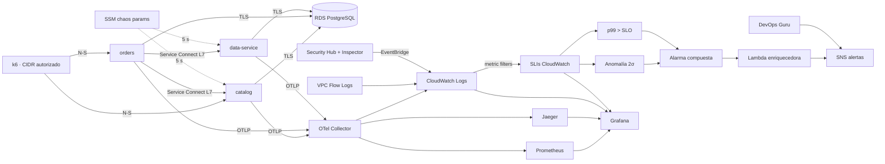

# ID-003 — Plan general: sistema observable integrado en AWS

## Identificación

| Campo | Detalle |
|---|---|
| ID | ID-003 |
| Título | Sistema observable completo en AWS. |
| Sprint / iteración | No documentado. |
| Prioridad | Alta |
| Estado global | Fases 1–4 implementadas sin validar en AWS; fase 5 con autoevaluación provisional. Validación automatizada aprobada en local. |
| Sistemas y repositorios afectados | `services/` (catalog, orders, data, shared), `compose.yaml`, `docker/`, `infra/aws-observable`, `infra/tf_modules/{vpc-observable,rds,ecs-observable,aiops,security-observability}`, `infra/lambda`, `infra/gcp-observable`, `scripts/`, `tests/`. |
| Iniciativas relacionadas | ID-001 y ID-002 (base funcional e instrumentación). |

## Resumen de estado

El código, la IaC, los dashboards y los scripts están implementados. En el entorno de desarrollo se aprobaron 18 pruebas automatizadas (incluida una integración contra PostgreSQL que verifica los atributos DB semconv), `otelcol-contrib validate` sobre la configuración del Collector, `promtool check rules` y el análisis sintáctico de los 37 archivos HCL. También se ejecutó un smoke local de los tres servicios con caos activo y Collector/Prometheus reales: la traza cruzó los tres servicios, las reglas de registro devolvieron series para los tres trabajos y el histograma `db.client.operation.duration` quedó disponible. Queda pendiente `terraform validate/plan/apply`, el despliegue en AWS, la línea base de carga, los dos experimentos de caos y la captura de evidencias.

## Enfoque técnico

Cada tarea de aplicación encadena `db-bootstrap` → `migrate` → `app`. El Collector recibe OTLP por el alias `otel-collector:4317` y obtiene métricas por los alias `*-metrics`. Los logs OTel en CloudWatch generan SLIs con percentiles; sobre ellos actúan las bandas de anomalía, el SLO de latencia y las alarmas compuestas. La Lambda agrega evidencia desde Logs Insights. El caos se controla en caliente con parámetros SSM.

## Contratos e interfaces afectados

| Elemento | Ubicación | Cambio | Compatibilidad hacia atrás |
|---|---|---|---|
| API data-service | `services/data` | Nuevo: `POST /records`, `GET /records/{id}`, `GET /reports/summary`, salud. | Nuevo servicio. |
| API pedidos | `services/orders` | Nuevo `GET /orders/summary`; registro en data-service tras guardar. | Aditivo; `POST /orders` sin cambios. |
| Variables de entorno | Tres servicios | `DB_SSLMODE`, `CHAOS_*`, `DATA_SERVICE_BASE_URL`, `DB_CLOUD_PROVIDER`. | Opcionales con valores por defecto. |
| Atributos DB de spans | Tres servicios | Convenciones estables (`db.query.text`, `db.namespace`, `db.system.name`). | Cambia nombres de atributos respecto a ID-002 (D-310). |
| Compose | `compose.yaml` | `data-bootstrap`, `data-migrate`, `data-service`; `DATA_DB_PASSWORD`. | `init-local-env.py` agrega claves faltantes sin sobrescribir. |
| IaC | `infra/aws-observable` | Nuevo root independiente de `infra/otel-ecs-lab`. | ID-002 no se modifica. |

## Fases de ejecución

| Estado | # | Documento | Requisitos que cubre | Sistemas | Resultado esperado |
|---|---|---|---|---|---|
| Implementada sin validar | 1 | [Arquitectura observable y data-service](01-arquitectura-data-service.md) | RF-301–RF-307, RNF-301, RNF-302, RNF-304, RNF-306, RNF-307 | Servicios, Compose, Collector, ECS, RDS, Service Connect. | Tres servicios en ECS con RDS, malla L7 y spans DB semconv. |
| Implementada sin validar | 2 | [AIOps: anomalías y correlación](02-aiops-correlacion.md) | RF-311–RF-314 | CloudWatch, SNS, Lambda, DevOps Guru, scripts AIOps. | Alertas correlacionadas enriquecidas y reporte de ruido. |
| Implementada sin validar | 3 | [Red y seguridad](03-red-seguridad.md) | RF-321–RF-324 | VPC Flow Logs, Security Hub, Inspector, EventBridge, Grafana. | Dashboard de Golden Signals de Seguridad y alertas. |
| Implementada sin validar | 4 | [Caos y MTTD](04-caos-mttd.md) | RF-331–RF-334, RNF-305 | Middleware de caos, SSM, runner, Prometheus. | Dos experimentos con MTTD, SLO y error budget. |
| En curso | 5 | [Madurez, roadmap y entrega](05-madurez-roadmap.md) | RF-341, RF-342, RF-351, RF-352, RNF-303 | Documentación, evidencias, repositorio. | Autoevaluación, roadmap y paquete de evidencias. |

## Cobertura de requisitos

| Estado de cobertura | Requisito | Fase que lo cubre |
|---|---|---|
| Implementado; validado en local | RF-301, RF-302, RF-303, RF-304 | Fase 1 |
| Implementado; AWS pendiente | RF-305, RF-306 | Fase 1 |
| Implementado; validado en local | RF-307 | Fase 1 |
| Implementado; AWS pendiente | RF-311, RF-312, RF-313 | Fase 2 |
| Implementado; lógica validada con pruebas; datos AWS pendientes | RF-314 | Fase 2 |
| Implementado; AWS pendiente | RF-321, RF-322, RF-323, RF-324 | Fase 3 |
| Implementado; validado en local | RF-331 | Fase 4 |
| Implementado; ejecución pendiente | RF-332, RF-333, RF-334 | Fase 4 |
| Provisional (A-301) | RF-341, RF-342 | Fase 5 |
| Pendiente (operación del equipo) | RF-351, RF-352 | Fase 5 |
| Implementado | RNF-301–RNF-307 | Fases 1–5 |

## Dependencias y orden de ejecución

La fase 1 es prerequisito de todas. Las fases 2 y 3 pueden desplegarse juntas con el mismo `terraform apply`. La fase 4 depende de las fases 1 y 2 y de una línea base de carga suficiente para las bandas de anomalía (S-305). La fase 5 consume la evidencia de las fases 1–4.

## Prerequisitos operativos

| Estado | Prerequisito | Tipo | Impacto si falta |
|---|---|---|---|
| Pendiente | Cuenta AWS sandbox con permisos para VPC, ECS, ECR, RDS, IAM, CloudWatch, Lambda, SNS, SSM, Security Hub, Inspector y DevOps Guru. | Acceso | Bloquea el despliegue. |
| Pendiente | Habilitar DevOps Guru antes del 29-10-2026 si la cuenta es nueva en el servicio. | Plazo externo | RF-312 queda solo con CloudWatch anomaly detection. |
| Pendiente | Terraform ≥ 1.6, Docker con buildx, k6 y AWS CLI v2 en el equipo local. | Herramientas | Bloquea build, apply y experimentos. |
| Pendiente | CIDR propio actualizado en `terraform.tfvars`. | Configuración | Sin acceso a APIs y consolas. |
| Pendiente | Línea base de carga ≥ 3 h antes de los experimentos. | Operación | Bandas de anomalía poco fiables y MTTD no representativo. |
| Confirmado | Repositorio con ID-001/ID-002 como base. | Repositorio | Ninguno. |

## Riesgos y limitaciones

| Riesgo o limitación | Detalle | Impacto | Mitigación o decisión | Bloqueante |
|---|---|---|---|---|
| IaC sin `terraform validate` | El entorno de desarrollo no tiene acceso al registro de Terraform; solo se verificó sintaxis HCL y coherencia de variables. | Alto | Ejecutar `terraform init && terraform validate && terraform plan` antes del apply y corregir. | Para deploy |
| Entrenamiento de bandas | Con poco historial la banda de anomalía es ancha o inestable. | Alto | Línea base ≥ 3 h; ajustar `anomaly_band_stddev`; la regla exige además el SLO. | Para fase 4 |
| MTTD cercano a 2 min | Metric filters con resolución de 60 s, lote del Collector de 2 s y evaluación por minuto. | Medio | Periodos de 60 s y 1 de 1 punto; medir y reportar el valor real sin ajustarlo. | No |
| DevOps Guru en retiro | No acepta clientes nuevos desde el 29-10-2026. | Medio | Habilitarlo antes o documentarlo como limitación; CloudWatch cubre la regla. | No |
| Recursos de cuenta | Security Hub/Inspector pueden estar habilitados previamente. | Medio | Variables `enable_security_hub` y `enable_inspector`. | No |
| Costo | Fargate, RDS, IPv4 públicas y alarmas de anomalía. | Bajo | `desired_count = 0` y `terraform destroy` al terminar. | No |
| Grafana CloudWatch JSON | Paneles CloudWatch generados por script sin probar en UI. | Medio | Validar en el despliegue; ajustar el generador si una consulta no renderiza. | Para evidencia |

## Estrategia de validación

| Estado | Nivel | Qué cubre | Ejecución |
|---|---|---|---|
| Aprobada en entorno local | Automatizada | Caos, DB semconv (unitaria e integración PostgreSQL 16), enriquecedor, métricas de seguridad, reproducción de ruido. | `python3 -m pytest -q` → 18 pruebas aprobadas. |
| Aprobada en entorno local | Estática | Collector, reglas Prometheus, HCL, compilación Python. | `otelcol-contrib validate`, `promtool check rules`, `python-hcl2`, `py_compile`. |
| Aprobada en entorno local | Smoke funcional | Tres servicios con caos y Collector/Prometheus reales. | Ver fase 1 y fase 4. |
| Pendiente de confirmación | Funcional AWS | Despliegue, trazas, dashboards, alarmas, experimentos. | `infra/aws-observable/README.md`. |
| Pendiente | Reversión | `terraform destroy`. | Confirmar ausencia de servicios ECS y RDS. |

## Criterios de cierre del plan

- [ ] `terraform validate` y `plan` sin errores; `apply` completo.
- [ ] Traza C-301 visible en Jaeger con spans DB semconv; dashboards con series no vacías.
- [ ] Línea base ≥ 3 h y reporte de ruido generado.
- [ ] Experimentos 1 y 2 con MTTD ≤ 120 s, análisis de SLO/error budget y alerta accionable.
- [ ] Golden Signals de Seguridad con datos reales (logins fallidos, flujos, CVEs).
- [ ] A-301 resuelta y autoevaluación ajustada; roadmap aprobado.
- [ ] Repositorio público con etiqueta `v1.0`, video y PDF entregados.
- [ ] `terraform destroy` ejecutado.
- [ ] Gates 3 y 4 completados.

## Referencias

- [`00-especificacion.md`](00-especificacion.md), fases [`01`](01-arquitectura-data-service.md) a [`05`](05-madurez-roadmap.md) e [`informe final`](99-informe-final.md).
- [`infra/aws-observable/README.md`](../../infra/aws-observable/README.md) — runbook de despliegue y experimentos.
